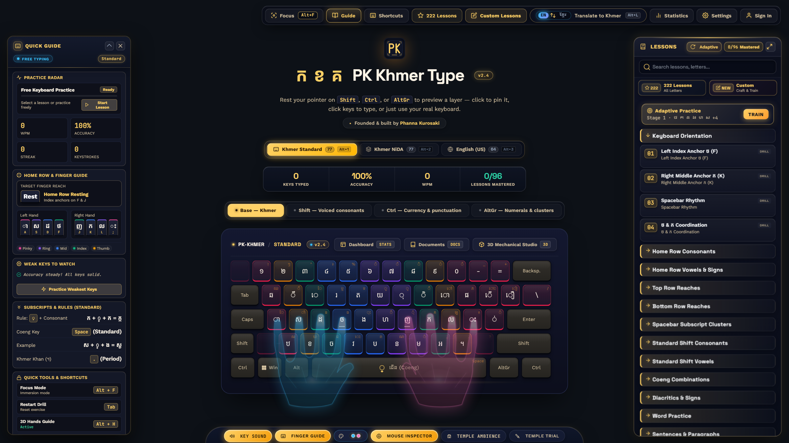
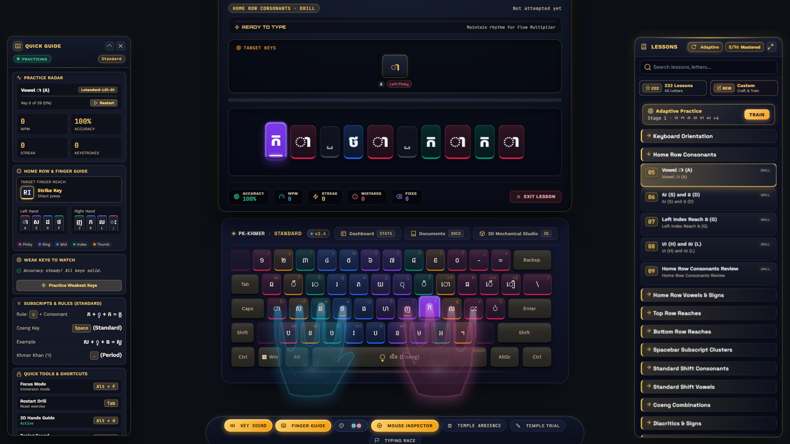
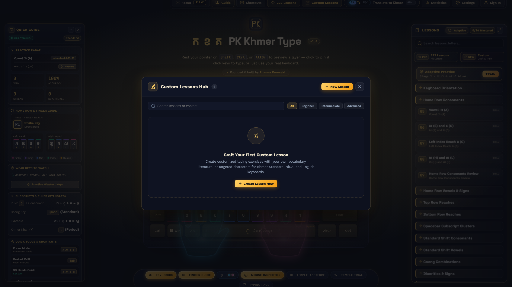
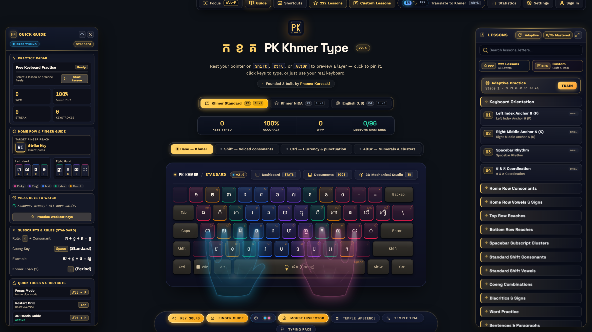

<div align="center">

  

  # PK KHMER TYPE
  ### ស្ទូឌីយោហ្វឹកហាត់វាយអក្សរខ្មែរ PK — High-Performance Touch Typing Studio

  <p>
    <b>The definitive touch-typing studio for Cambodian Unicode (Standard &amp; NiDA) and English.</b><br />
    Engineered with pure vanilla web standards, real-time biomechanical 3D hand kinematics, procedural mechanical audio synthesis, and a sub-0.05ms zero-reflow typing engine.
  </p>

  <p>
    <a href="https://not-phana.github.io/PK-Khmer-Type/">
      
    </a>
    <a href="https://not-phana.github.io/PK-Khmer-Type/welcome.html">
      
    </a>
    <a href="https://not-phana.github.io/PK-Khmer-Type/dashboard.html">
      
    </a>
    <a href="https://not-phana.github.io/PK-Khmer-Type/Documents/index.html">
      
    </a>
    <a href="https://not-phana.github.io/PK-Khmer-Type/Documents/index.html#keycap-3d">
      
    </a>
    <a href="https://not-phana.github.io/PK-Khmer-Type/concepts/entropy-engine.html">
      
    </a>
    <a href="https://github.com/not-Phana/PK-Khmer-Type/raw/main/downloads/KhmerKeyboard-Setup.exe">
      
    </a>
  </p>

  <p>
    
    
    
    
    
    
    
  </p>

  <br />

  

</div>

---

```text
====================================================================================================
  PK KHMER TYPE :: SOVEREIGN TOUCH-TYPING ENGINE & HIGH-PERFORMANCE LEARNING STUDIO
====================================================================================================
  [LOCAL-FIRST]   100% Offline execution via file:/// with optional zero-friction Supabase cloud sync.
  [KHMER UNICODE] Flawless abugida handling: base consonants, Coeng subjoined stacks, and vowels.
  [KINEMATICS]    Real-time 3D translucent biomechanical hands tracking key reaches and modifiers.
  [AUDIO SYNTH]   Zero audio file requests; pure Web Audio synthesis of tactile mechanical switches.
  [PERFORMANCE]   Zero forced-reflow pipeline targeting native 120 FPS display refresh rates.
  [ZERO-EMOJI]    Strict zero-emoji protocol across entire application; 100% crisp inline SVG vectors.
====================================================================================================
```

---

## Table of Contents

- [Executive Summary](#executive-summary)
- [Comparative Architectural Analysis](#comparative-architectural-analysis)
- [Visual Showcase](#visual-showcase)
- [Core Engineering Pillars](#core-engineering-pillars)
  - [1. Zero Forced-Reflow Engine (< 0.05ms Input Latency)](#1-zero-forced-reflow-engine--005ms-input-latency)
  - [2. Procedural Web Audio Mechanical Synthesizer](#2-procedural-web-audio-mechanical-synthesizer)
  - [3. Biomechanical 3D Hand Kinematics &amp; Opposite-Hand Choreography](#3-biomechanical-3d-hand-kinematics--opposite-hand-choreography)
  - [4. Sovereign Local-First + Supabase Cloud Sync Hybrid Topology](#4-sovereign-local-first--supabase-cloud-sync-hybrid-topology)
  - [5. Strict Zero-Emoji Design Protocol](#5-strict-zero-emoji-design-protocol)
- [The Khmer Abugida Typing Formula](#the-khmer-abugida-typing-formula)
  - [Golden Rule 1: Always Type the Base Consonant First](#golden-rule-1-always-type-the-base-consonant-first)
  - [Golden Rule 2: Subscript Consonants via Coeng (ជើងអក្សរ ្)](#golden-rule-2-subscript-consonants-via-coeng-ជើងអក្សរ-)
  - [Golden Rule 3: Visible Word Spaces (Shift + Space)](#golden-rule-3-visible-word-spaces-shift--space)
  - [Golden Rule 4: Dynamic 4-Layer Keyboards](#golden-rule-4-dynamic-4-layer-keyboards)
- [Complete 3-Track Curriculum (276 Lessons)](#complete-3-track-curriculum-276-lessons)
  - [The 9-Stage Progressive Learning Path](#the-9-stage-progressive-learning-path)
  - [Grandmaster Literature &amp; Classical Scriptorium (54 Bonus Lessons)](#grandmaster-literature--classical-scriptorium-54-bonus-lessons)
- [Interactive Studio Modes &amp; Practice Hubs](#interactive-studio-modes--practice-hubs)
  - [Custom Lessons Studio (v1.2+)](#custom-lessons-studio-v12)
  - [Adaptive Weakness Scoring Engine](#adaptive-weakness-scoring-engine)
  - [Standardized Test Lab &amp; Certification](#standardized-test-lab--certification)
  - [Ghost Race Multiplayer Simulation](#ghost-race-multiplayer-simulation)
  - [Smart Mouse Cursor Inspector HUD](#smart-mouse-cursor-inspector-hud)
  - [3D Keycap Mechanical Studio &amp; Retro CRT Terminal](#3d-keycap-mechanical-studio--retro-crt-terminal)
- [Keyboard Shortcuts](#keyboard-shortcuts)
- [Quick Start Guide](#quick-start-guide)
- [Automated Testing &amp; Verification](#automated-testing--verification)
- [Project Architecture &amp; File Map](#project-architecture--file-map)
- [Author &amp; License](#author--license)

---

## Executive Summary

Typing the Cambodian abugida script should feel just as rapid, fluid, and intuitive as typing English.

Most international typing tutors treat Khmer as a secondary afterthought: characters decompose incorrectly, subscript clusters break across line wraps, keyboard layouts do not reflect Cambodian national standards, and heavy frameworks cause perceptible typing lag.

**PK Khmer Type** was engineered from the ground up to solve these fundamental challenges. Built with pure web standards (HTML5, CSS3, Vanilla ES6+ modules), it delivers sub-millisecond tactile responsiveness, complete offline independence, anatomically grounded finger guidance, and comprehensive coverage of both the **Khmer Standard (Unicode)** and **Khmer NiDA** keyboard standards alongside **English US QWERTY**.

---

## Comparative Architectural Analysis

| Architectural Pillar | Generic Web Typing Tutors | PK Khmer Type Studio |
| :--- | :--- | :--- |
| **Framework Overhead** | Heavy React/Vue/Angular bundles (> 2MB to 5MB) | **100% Pure Vanilla JS/CSS** (< 250KB total footprint) |
| **Keystroke Input Latency** | 8ms to 28ms (Virtual DOM reconciliation &amp; reflows) | **< 0.05ms** (Direct DOM patching with geometry caching) |
| **Khmer Layout Support** | Single unofficial mapping or missing | **Khmer Standard, Official NiDA, &amp; English QWERTY** |
| **Subscript (Coeng ្)** | Unhandled, broken cursor indices, or misaligned stacks | **Atomic typing units with NFC canonical decomposition repair** |
| **Audio Feedback** | Heavy static `.mp3` / `.wav` asset downloads | **100% Procedural Web Audio API** (zero network asset downloads) |
| **Finger Guidance** | Static flat 2D color blocks | **Real-time 3D biomechanical hands** with modifier kinematics |
| **Data Sovereignty** | Forced sign-ups, third-party analytics, ads, and telemetry | **100% Local-First**, runs offline via `file:///`, optional cloud sync |
| **Operating Cost** | Recurring cloud databases and API bills | **$0.00 Forever** (Sovereign static client architecture) |
| **Visual Iconography** | Inconsistent OS emojis (broken on Linux/old Windows) | **Strict Zero-Emoji Policy**: 100% crisp inline SVG vectors |

---

## Visual Showcase

<table>
  <tr>
    <td width="50%" valign="top">
      <h3 align="center">Real-Time Biomechanical Hand Guides</h3>
      
      <p align="center">
        <em>Translucent anatomical hands dynamically calculate real-time finger travel paths, natural metacarpal arching, and opposite-hand modifier reaches (Shift, AltGr, Ctrl).</em>
      </p>
    </td>
    <td width="50%" valign="top">
      <h3 align="center">Custom Lessons Crafting Studio</h3>
      
      <p align="center">
        <em>Paste, edit, shuffle, repeat, and clean custom drills. Fully preserves complex Khmer Unicode (vowels, Coeng ្, diacritics) across browser sessions.</em>
      </p>
    </td>
  </tr>
  <tr>
    <td width="50%" valign="top">
      <h3 align="center">Cinematic Focus Mode (Alt + F)</h3>
      
      <p align="center">
        <em>Eliminate all sidebars, toolbars, and extraneous HUD components with a single keystroke, centering the manuscript and physical keycaps for pure flow.</em>
      </p>
    </td>
    <td width="50%" valign="top">
      <h3 align="center">Official Khmer NiDA &amp; Standard Layouts</h3>
      
      <p align="center">
        <em>Native support for Khmer Standard, Official NiDA, and English QWERTY layouts with instant <code>Alt + 1/2/3</code> switching and real-time layer indicators.</em>
      </p>
    </td>
  </tr>
</table>

---

## Core Engineering Pillars

### 1. Zero Forced-Reflow Engine (< 0.05ms Input Latency)

Traditional web applications suffer from **layout thrashing**: querying computed DOM dimensions (`offsetWidth`, `getBoundingClientRect`) during high-frequency keystroke events forces the browser engine to halt execution and synchronously recalculate styles and geometry across the entire page.

PK Khmer Type eliminates layout thrashing completely through four coordinated architectural mechanisms:

```text
+------------------------------------------------------------------------------------------------+
|                             ZERO FORCED-REFLOW EXECUTION PIPELINE                              |
+------------------------------------------------------------------------------------------------+
  [Keystroke Event]
         |
         v
  [Unicode Normalizer] ----> Fast NFC canonical equivalence & decomposed vowel repair
         |
         v
  [Atomic Unit Match]  ----> Evaluates base consonants, Coeng subscript stacks, or vowels
         |
         v
  [ClassList Patch]    ----> GPU-composited CSS transforms (.pressed, .struck, .active)
         |
         v
  [Coordinate Lookup]  ----> keyCoordCache (WeakMap / Precomputed in single synchronous pass)
         |
         v
  [Web Audio Synth]    ----> Low-latency procedural sound impulse (Zero file fetches)
         |
         +-----------------> Total execution duration: < 0.05ms (Native 120Hz/240Hz frame budget)
```

- **Scroll-Invariant Coordinate Pre-Population**: All physical keycap boundaries are precomputed synchronously against `boardWrap` during layout initialization (`recalibrateCoordinates`). In-session lookups never read viewport dimensions piecemeal, completely preventing scroll-induced coordinate drift.
- **Content Visibility & Layout Deferral**: Offscreen lesson cards, leaderboard rows, and settings dialogs utilize modern CSS `content-visibility: auto` and `contain-intrinsic-size: auto 64px`, drastically reducing style and paint overhead during initial page load.
- **Particle Buffer Geometries**: Typing burst rings and spark animations read element dimensions directly from cached geometry objects rather than querying `el.offsetHeight`.
- **Debounced Persistence**: Practice metrics and active session states debounce disk serialization (400ms) into `localStorage`, reserving immediate synchronous writes strictly for `beforeunload` events.

---

### 2. Procedural Web Audio Mechanical Synthesizer

PK Khmer Type eliminates audio file downloads entirely. Physical tactile switch clicks, bottom-out clacks, and stone hall reverbs are synthesized procedurally in real time using the **Web Audio API**:

```text
+------------------------------------------------------------------------------------------------+
|                                PROCEDURAL AUDIO SYNTHESIZER                                    |
+------------------------------------------------------------------------------------------------+
  [Key Strike Down] ---> [Noise / Transient Impulse] ---> [Biquad Filter 1] ---> [Gain Decay]
                                                                  |
                                                         [Biquad Filter 2] ---> [Dynamic Pan]
                                                                  |
                                                         [Master Reverb]   ---> [Audio Output]
```

- **Topre Thock**: Dual resonant bandpass filters (low Q) driven by a soft sub-bass sine impulse, modeling the deep acoustic thock of electro-capacitive rubber dome collapse.
- **Holy Panda**: Sharp high-frequency transient spike paired with a high-Q bandpass peak (600Hz–1200Hz), faithfully capturing the distinctive tactile bump and housing bottom-out.
- **Cherry MX Blue**: High-frequency click-leaf snapping burst (3kHz–6kHz) accompanied by rapid exponential decay and subtle metallic spring resonance.
- **Silent Linear**: Heavily attenuated low-pass filtered impulse (cutoff 450Hz) simulating internal silicone stem dampeners for silent library study.
- **Temple Hall Ambience**: Convolution reverb engine synthesizing realistic stone chamber acoustic reflections.

---

### 3. Biomechanical 3D Hand Kinematics & Opposite-Hand Choreography

The visual hand guide models authentic human ergonomics:

```text
+------------------------------------------------------------------------------------------------+
|                                KINEMATIC HAND GUIDE ARCHITECTURE                               |
+------------------------------------------------------------------------------------------------+
  [Target Keycap]  ---> [Finger Code Lookup (L1-L5 / R1-R5)]
                               |
                               +---> [Modifier Check: Shift / AltGr / Ctrl]
                                           |
    +--------------------------------------+--------------------------------------+
    |                                                                             |
    v                                                                             v
  [Primary Striking Hand]                                               [Opposite Modifier Hand]
  - Metacarpal Knuckle Arch Calculation                                  - Outward Wrist Pivot
  - Cubic Bezier Control Points (p0, p1, p2, p3)                         - Modifier Key Alignment
  - Physiological Extension Limiter (maxLen)                             - Non-Active Digits Rest
  - Active Fingertip Pad Beacon                                          - Dual Shockwave Ring Burst
```

- **10 Biomechanical States**: Fused immutable state machine (`HAND_STATES`) handling `HOME_REST`, `REACHING`, `PRESSING`, `HOLDING`, `RELEASING`, `STRIKING`, and `GHOST_HOVER`.
- **Opposite-Hand Rule**: When a character requires `Shift` (or `Ctrl`), the platform strictly enforces touch-typing ergonomics: if the target character is struck by the left hand, the right pinky (`R5`) depresses `ShiftRight`; if struck by the right hand, the left pinky (`L5`) depresses `ShiftLeft`.
- **Unified Hand Silhouette**: Procedural SVG contour generator (`buildUnifiedHandSVG`) traces a single mirror-symmetric anatomical polygon along digits, purlicue webs, and radial/ulnar wrist boundaries.
- **Reduced Motion & Performance Sync**: Respects user preferences (`anim-mode-minimal`, `performance-mode`, `prefers-reduced-motion`) by snapping fingers instantly to target keycaps and halting unnecessary background animation loops.

---

### 4. Sovereign Local-First + Supabase Cloud Sync Hybrid Topology

PK Khmer Type champions user privacy, educational sovereignty, and long-term durability:

```text
                                  +-----------------------------+
                                  |   Browser Local Storage     |
                                  |   - Unlocked Lessons        |
                                  |   - WPM & Accuracy Totals   |
                                  |   - Custom Lessons v1       |
                                  |   - User Settings           |
                                  +-----------------------------+
                                                 |
                                     (Optional / User-Initiated)
                                                 v
                                  +-----------------------------+
                                  |   Supabase Cloud Engine     |
                                  |   - Monotonic Progress Sync |
                                  |   - Account Cockpit Backups |
                                  |   - Row-Level Security (RLS)|
                                  +-----------------------------+
```

- **100% Offline Capability**: Runs seamlessly directly from disk via `file:///` or through the cached Service Worker PWA. No server connection is ever required to practice.
- **Zero Mandatory Accounts**: All 276 curriculum lessons, test lab assessments, custom lesson tools, and analytics are accessible instantly with zero registration gates.
- **Optional Cloud Backup**: Users can optionally connect their free Supabase backend to synchronize progress across multiple computers, complete with cryptographically isolated Row-Level Security (RLS) policies.
- **Monotonic Progress Merging**: Offline practice is never overwritten by older cloud snapshots; the synchronization engine deterministically merges the highest mastery scores and lesson completions.

---

### 5. Strict Zero-Emoji Design Protocol

In strict adherence to professional typographical standards and visual predictability:
- **Zero Emoji Unicode Glyphs**: No system emojis (e.g. smileys, rockets, sparkles, flags) exist in HTML, CSS, JavaScript, documentation, or commit messages. System emojis render inconsistently across operating systems and break visual hierarchy.
- **Crisp Inline SVG Icons**: All UI badges, buttons, tooltips, and status indicators use crisp vector SVG paths (`stroke="currentColor"`, `stroke-width="2.2"`, `stroke-linecap="round"`, `stroke-linejoin="round"`).

---

## The Khmer Abugida Typing Formula

Khmer is an **abugida** writing system. Vowels and subscript consonants do not simply follow sequentially; they cluster dynamically around and below an initial base consonant:

```text
+--------------------------------------------------------------------------------------------------+
|                                    KHMER ABUGIDA TYPING FORMULA                                  |
+--------------------------------------------------------------------------------------------------+

       [Base Consonant]   +   [Coeng Sign ្]   +   [Subscript Consonant]   +   [Vowel Sign]

             ក (K)         +        ្ (Coeng)    +           ខ (Kh)          +       េ (E)

                                         =  ក្ខេ  (Kkhe)
+--------------------------------------------------------------------------------------------------+
```

### Golden Rule 1: Always Type the Base Consonant First
Type the base consonant first, even when its dependent vowel visually appears to the left (e.g. `េ`, `ែ`, `ៃ`, `ោ`, `ៅ`), above, or below the consonant.

### Golden Rule 2: Subscript Consonants via Coeng (ជើងអក្សរ ្)
To stack a consonant beneath a leading consonant, strike the layout's dedicated **Coeng key** before typing the second consonant:

| Keyboard Layout | Coeng Trigger Key | Keystroke Recipe | Rendered Syllable |
| :--- | :---: | :--- | :---: |
| **Khmer Standard** | `Space` | `ក` + `Space` + `ខ` | **ក្ខ** |
| **Khmer NiDA** | `J` (`្`) | `ក` + `J` + `ខ` | **ក្ខ** |

### Golden Rule 3: Visible Word Spaces (Shift + Space)
Because the physical `Space` bar acts as the Coeng (`្`) trigger on the Khmer Standard layout, press **`Shift + Space`** to insert a true visible word break between grammatical phrases.

### Golden Rule 4: Dynamic 4-Layer Keyboards
Both Khmer layouts map characters across four functional layers:
- **Base Layer**: Primary unvoiced consonants and fundamental dependent vowels.
- **Shift Layer**: Voiced consonants (`ព្យញ្ជនៈឃោសៈ`), upper diacritics, and compound vowels.
- **Ctrl Layer**: Currency symbols (`៛`, `$`, `€`), Khmer independent vowels (`ស្រៈពេញតួ`), and rare punctuation.
- **AltGr Layer (Right Alt)**: Cambodian numerals (`០–៩`), lunar calendar signs, and classical ligature roots.

---

## Complete 3-Track Curriculum (276 Lessons)

PK Khmer Type includes **276 verified lessons** taking learners from absolute zero to comprehensive scribe mastery:

| Curriculum Track | Levels | Core Lessons | Bonus Vault | Total Lessons | Core Pedagogical Focus |
| :--- | :---: | :---: | :---: | :---: | :--- |
| **Khmer Standard** | 16 | 77 | 18 | **96** | Home row anchors -> Consonants -> Vowels -> Coeng stacks -> Classic literature |
| **Khmer NiDA** | 16 | 77 | 18 | **96** | Administrative NiDA layout -> Vowel clusters -> Complex subscripts -> Epic prose |
| **English (US)** | 16 | 68 | 18 | **84** | Home row -> Alphabet reaches -> Numbers -> Symbols -> Homeric &amp; Shakespearean texts |
| **Total Platform** | **48** | **222** | **54** | **276** | **Zero-to-fluent mastery across all three major keyboard layouts** |

### The 9-Stage Progressive Learning Path

Every track is organized into 9 pedagogical stages:

```text
[Stage 1: Home Anchors] --------> [Stage 2: Core Consonants & Vowels] --------> [Stage 3: Vertical Reaches]
           |                                                                                  |
           v                                                                                  v
[Stage 6: Syntactic Flow] <------- [Stage 5: High-Frequency Lexicon] <------- [Stage 4: Coeng Subscript Stacks]
           |
           v
[Stage 7: Cultural Prose] -------> [Stage 8: Speed & Fatigue Drills] -------> [Stage 9: Grandmaster Scribe]
```

1. **Stage 1: Home Row Anchors** — Tactile resting points (`F`/`J` or `ក`/`ស`), wrist alignment, and baseline rhythm.
2. **Stage 2: Core Consonants & Vowels** — Foundational alphabet reaches and symmetric left/right hand alternation.
3. **Stage 3: Kinematic Row Traversal** — Vertical reaches to top and bottom rows with minimal palm displacement.
4. **Stage 4: Subscripts & Coeng Stacks** — Complex consonant clustering, compound vowels, and Shift coordination.
5. **Stage 5: High-Frequency Vocabulary** — Daily conversational words, functional verbs, and essential nouns.
6. **Stage 6: Syntactic Flow & Punctuation** — Full sentence rhythm, question marks, quotation marks, and visible word spaces (`Shift + Space`).
7. **Stage 7: Extended Cultural Literature** — Multi-sentence paragraphs covering historical, cultural, and environmental texts.
8. **Stage 8: Speed, Endurance & Error Refinement** — High-intensity sprints building neuromuscular stamina.
9. **Stage 9: Grandmaster Scribe Certification** — Comprehensive final assessments measuring real-world WPM and accuracy.

### Grandmaster Literature & Classical Scriptorium (54 Bonus Lessons)

Completing all 222 base lessons unlocks the prestigious **Level 222+ Bonus Vault** (18 bonus lessons per layout, 54 total), featuring verified authentic historical manuscripts:
- **Angkor Wat Stone Stelae Inscriptions** (Pre-Angkorian and classical epigraphy)
- **Reamker Epic Poetry** (Classical Cambodian poetic cadence)
- **Tum Teav** (Cambodian literary romance verses)
- **Chbap Srey & Chbap Pros** (Ancestral moral codes and deep wisdom)
- **Buddhist Suttas** (Mangala Sutta, Karaniya Metta Sutta, high Pali-Sanskrit compound roots)
- **The Constitution of Cambodia** (Modern administrative and constitutional law)
- **Homeric Epics & Shakespearean Drama** (Mastery English literature)

---

## Interactive Studio Modes & Practice Hubs

### Custom Lessons Studio (v1.2+)
Create custom drills with zero data loss:
- **Starter Template Library**: Instant one-click starter packs spanning Khmer Consonants, Coeng Clusters, Dependent Vowels, Pali Roots, and English Pangrams.
- **Text Crafting Tools**: `Repeat` (loop drills for endurance), `Shuffle Words` (prevent muscle memory memorization), `Add Spaces` (insert automatic spacing), `Clean Spaces` (strip redundant whitespace).
- **Unicode Inspection**: Real-time analysis of unique character units, diacritic density, and layout compatibility.
- **Local JSON Export & Import**: Backup and restore custom exercises directly to disk with prototype-pollution sanitized validation.

### Adaptive Weakness Scoring Engine
- **Confidence-Aware Error Scoring**: Tracks error frequencies and reaction latency across every individual key. Characters are never flagged as weak from an isolated slip; rigorous statistical thresholds require multiple observations.
- **Dynamic Syllable Synthesis**: Procedurally generates targeted remedial drills combining identified weak keys with mastered anchor characters, strictly maintaining valid Khmer phonotactic structure.

### Standardized Test Lab & Certification
- Formal timed sprints (1-minute, 3-minute, and 5-minute modes).
- Strict accuracy thresholds awarding verifiable certificates across six tiers: **Novice**, **Apprentice**, **Journeyman**, **Artisan**, **Master**, and **Grandmaster Scribe**.

### Ghost Race Multiplayer Simulation
- Real-time typing sprints against simulated bot pacers across varying WPM profiles.
- Live progress avatars, dynamic leaderboard rankings, and post-race telemetry summaries.

### Smart Mouse Cursor Inspector HUD
- Toggleable via `Alt + M` or toolbar button.
- Floating learning HUD following the cursor across keycaps, displaying International Phonetic Alphabet (IPA) pronunciation, consonant series (`1st / 2nd`), subjoined glyph forms, and step-by-step keystroke recipes.

### 3D Keycap Mechanical Studio & Retro CRT Terminal
- **3D Mechanical Studio**: Interactive Three.js simulation demonstrating mechanical switch travel, stem actuation, and keycap physics.
- **DEC VT-220 CRT Terminal**: Retro typing simulator featuring authentic P1 (green), P3 (amber), and P4 (white) phosphor bloom, scanlines, and CRT curvature.

---

## Keyboard Shortcuts

| Key Combination | Action Description |
| :--- | :--- |
| `Shift` + `Space` | Insert visible word/sentence space (essential for Khmer Standard) |
| `Alt` + `1` | Switch instantly to **Khmer Standard Layout** |
| `Alt` + `2` | Switch instantly to **Khmer NiDA Layout** |
| `Alt` + `3` | Switch instantly to **English (US QWERTY) Layout** |
| `Alt` + `F` | Toggle **Cinematic Focus Mode** (hides chrome and sidebars) |
| `Alt` + `L` | Toggle Interface Language (English &lt;--&gt; Khmer) |
| `Alt` + `M` | Toggle **Smart Mouse Cursor Inspector HUD** |
| `Alt` + `S` | Open **Settings &amp; Theme Studio** |
| `?` | Display global **Shortcuts Cheat Sheet** |
| `Esc` | Close active modal / pause lesson / exit Focus Mode |

---

## Quick Start Guide

### Option 1: Zero-Installation Instant Run
Open `index.html` or `welcome.html` in any modern browser (Google Chrome, Microsoft Edge, Mozilla Firefox, Apple Safari, Brave, Opera). All 276 lessons, procedural audio synthesizers, 3D hand guides, and themes execute out of the box directly via `file:///`.

### Option 2: Local Development Server

```bash
# 1. Clone the repository
git clone https://github.com/not-Phana/PK-Khmer-Type.git
cd PK-Khmer-Type

# 2. Start Vite local development server
npm run dev

# Or launch the built-in zero-dependency Node HTTP server
node scripts/dev_server.js
```

Open `http://localhost:5174/` in your browser.

---

## Automated Testing & Verification

PK Khmer Type enforces continuous quality standards with zero tolerance for broken curriculum progressions, layout thrashing, or regressions:

```bash
# Run the complete automated test suite (159 test cases across 14 test files)
npm test

# Run strict curriculum integrity & progressive length audit (276 lessons)
npm run validate

# Run the core audit verification suite
node scripts/verify_audit_fixes.js
```

### Test Suite Highlights
- **159/159 Unit Tests Passing (100%)**: Validates Unicode NFC decomposition repair, Zero-Width Space compatibility, multi-codepoint NiDA cluster slicing, timer accuracy, monotonic progress merging, hand kinematics, and XSS sanitization.
- **276/276 Lessons Validated**: Verifies zero broken progression links, zero untaught character introductions, valid 5-stage length curves, and proper modifier key chip assignments.
- **Strict Zero-Emoji Automated Check**: Scans all source code, assets, and documentation to enforce 100% SVG vector compliance.

---

## Project Architecture & File Map

```text
.
├── index.html                      # Main touch-typing studio shell
├── welcome.html                    # Bilingual interactive welcome experience
├── dashboard.html                  # Live mastery telemetry and per-key heatmap
├── 404.html                        # GitHub Pages client-side fallback router
├── manifest.json                   # Progressive Web App (PWA) manifest
├── sw.js                           # Offline service worker cache
├── logo.svg                        # Vector brand crest (100% inline SVG)
├── DESIGN.md                       # Comprehensive design system specification
│
├── concepts/                       # Prototyping lab & experimental engines
│   ├── entropy-engine.html         # Retro DEC VT-220 CRT Terminal (P1/P3/P4 phosphors)
│   ├── celestial_starlight_pointer # 3D procedural canvas cursor pointer
│   └── lesson_chassis_redesigns/   # Ergonomic cockpit layout prototypes
│
├── profile/                        # Author biography and credentials
│   ├── Phana_Phley_KON_Biography.md# Official curriculum author profile
│   └── Phana_Phley_KON_Biography.html
│
├── downloads/                      # Standalone installers & desktop packages
│   └── KhmerKeyboard-Setup.exe     # Windows x64 offline desktop installer
│
├── docs/                           # Exhaustive technical documentation & blueprints
│   ├── PK-KHMER-TYPE-ULTIMATE-MASTER-PLAN.md  # Definitive 38-section architectural blueprint
│   ├── khmer_writing_system_reference.md      # Linguistic reference for Khmer abugida
│   ├── cloud-sync-setup.md                    # Supabase backend configuration guide
│   └── DESIGN.md                              # Temple-stone dark aesthetic design tokens
│
├── Documents/                      # In-app interactive documentation portal
│   ├── index.html                  # Interactive documentation hub
│   ├── docs.css                    # Documentation styling
│   ├── docs.js                     # Documentation controller & search
│   ├── keycap3d.js                 # Three.js 3D mechanical keycap simulator
│   └── three.min.js                # Three.js runtime library
│
├── css/                            # Modular styling architecture
│   ├── base.css                    # Design tokens, color palette, typography
│   ├── keyboard.css                # Keycaps, 3D hand overlays, layer HUDs
│   ├── typing.css                  # Prompt manuscript, caret animation, error shake
│   ├── lessons.css                 # Lesson docks, Grandmaster Vault, custom lesson UI
│   ├── settings.css                # Settings modal and theme toggles
│   ├── welcome.css                 # Welcome page animations and card layouts
│   └── responsive.css              # Responsive layout breakpoints (mobile/desktop)
│
├── js/                             # Modular JavaScript engine (ES6+ Vanilla)
│   ├── app.js                      # Application initialization and mode router
│   ├── keyboard.js                 # Layout rendering, zero-reflow keyCoordCache, hand kinematics
│   ├── typing.js                   # Keystroke engine, WeakMap FX caching, Web Audio synth
│   ├── lessons.js                  # 276-lesson curriculum runner, debounced active session save
│   ├── custom-lessons.js           # Custom lesson crafting, storage, and validation engine
│   ├── adaptive.js                 # Dynamic adaptive practice engine & weakness scoring
│   ├── test-lab.js                 # Standardized typing test lab & certification awards
│   ├── achievements.js             # Milestone and mastery badges system
│   ├── review.js                   # Spaced repetition and weak-key detector
│   ├── race.js                     # Typing race mode with simulated bot pacers
│   ├── cursor-inspector.js         # Anchored cursor HUD and phonetic tooltip
│   ├── quick_guide.js              # Quick Guide dock with mini keyboard telemetry
│   ├── cloud-sync.js               # Supabase cloud backup and restore integration
│   ├── auth-provider.js            # User authentication and account cockpit modal
│   ├── settings.js                 # Theme switcher and user preference manager
│   ├── statistics.js               # Lifetime analytics and WPM calculations
│   ├── smooth-cursor.js            # Smooth trailing cursor badge with idle sleep
│   └── shortcuts.js                # Global keyboard shortcut registry
│
├── data/                           # Verified curriculum databases
│   ├── keyboard.json               # Layout character maps for Standard, NiDA, English
│   ├── curriculum-data.js          # Pre-bundled 276-lesson runtime payload
│   └── curriculum/                 # Raw JSON level and exercise definitions
│       ├── standard/               # Khmer Standard curriculum (96 lessons)
│       ├── nida/                   # Khmer NiDA curriculum (96 lessons)
│       └── english/                # English US curriculum (84 lessons)
│
├── supabase/                       # Supabase configuration & database migrations
│   └── migrations/                 # PostgreSQL migrations with Row-Level Security (RLS)
│
├── tests/                          # Automated testing suite (14 test files, 159 tests)
│   ├── browser_global_scope.test.js
│   ├── cloud_sync.test.js
│   ├── comprehensive_audit_verification.test.js
│   ├── custom_lessons.test.js
│   ├── hand_biomechanics.test.js
│   ├── hand_hover_inspector_decoupling.test.js
│   ├── major_evolution_system.test.js
│   ├── offline_resilience.test.js
│   ├── performance_optimization_and_dead_code.test.js
│   ├── phase1_khmer_typing.test.js
│   ├── round3_audit_fixes.test.js
│   ├── security_hardening.test.js
│   ├── targeted_regressions.test.js
│   └── welcome_page.test.js
│
└── scripts/                        # Development & validation automation
    ├── dev_server.js               # Local static HTTP dev server
    ├── generate_supabase_config.js # Client-side Supabase environment injector
    ├── validate_curriculum.js      # Curriculum integrity & prerequisite validator
    └── verify_audit_fixes.js       # Core regression verification script
```

---

## Author & License

Designed and engineered with passion by **Phana Phley (Kon)** in Cambodia to make Khmer and English typing education modern, accessible, beautiful, and completely free for learners everywhere.

- **Lead Developer:** Phana Phley (Kon)
- **Repository:** [`not-Phana/PK-Khmer-Type`](https://github.com/not-Phana/PK-Khmer-Type)
- **License:** Open source under the [MIT License](LICENSE). Contributions, feedback, and educational deployments are warmly welcome.
