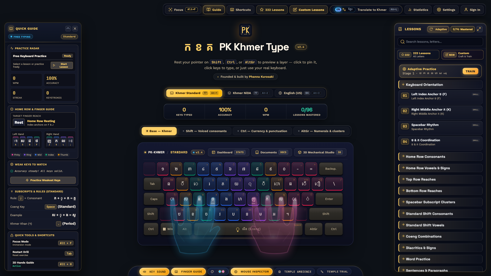
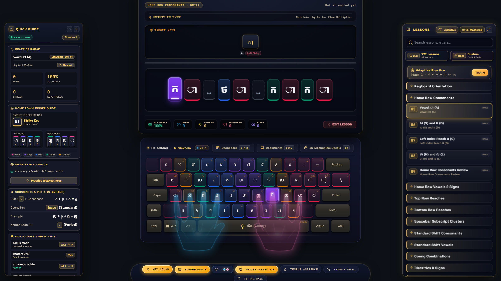
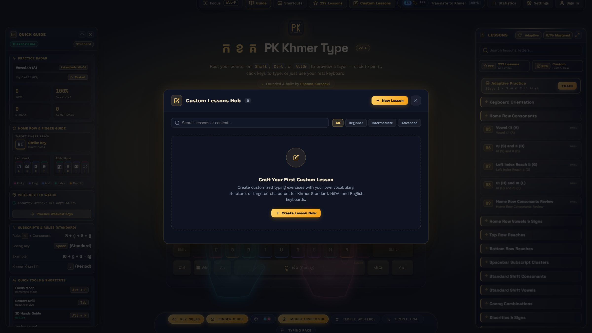
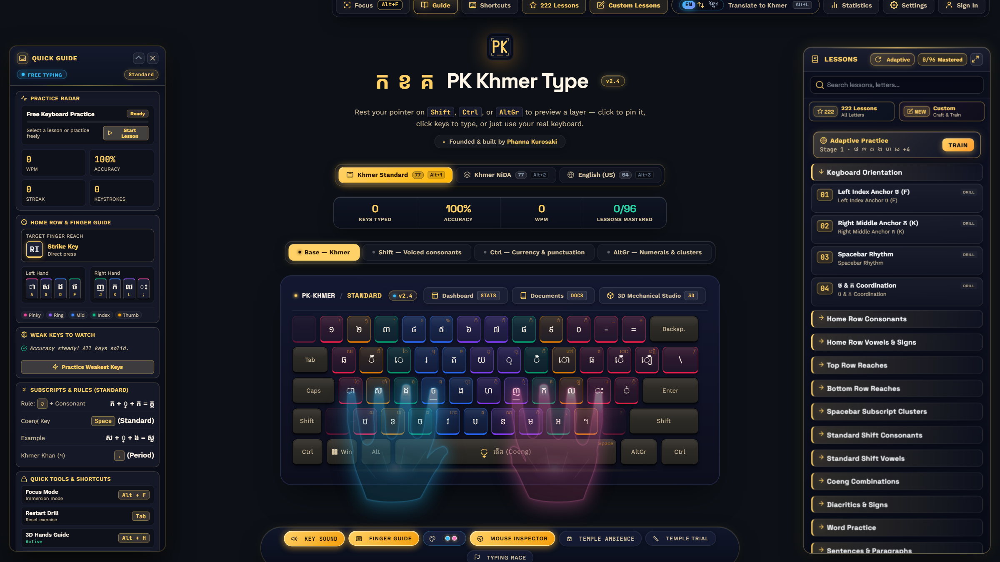

<div align="center">

  

  # PK KHMER TYPE
  ### ស្ទូឌីយោហ្វឹកហាត់វាយអក្សរខ្មែរ PK — High-Performance Touch Typing Studio

  <p>
    <b>The definitive touch-typing tutor for Khmer Unicode (Standard &amp; NiDA) and English.</b><br />
    Engineered with pure vanilla web standards, real-time biomechanical 3D hand kinematics, procedural mechanical audio synthesis, and a sub-0.05ms zero-reflow typing engine.
  </p>

  <p>
    <a href="https://not-phana.github.io/PK-Khmer-Type/">
      
    </a>
    <a href="https://not-phana.github.io/PK-Khmer-Type/welcome.html">
      
    </a>
    <a href="https://not-phana.github.io/PK-Khmer-Type/dashboard.html">
      
    </a>
    <a href="https://not-phana.github.io/PK-Khmer-Type/concepts/entropy-engine.html">
      
    </a>
    <a href="https://github.com/not-Phana/PK-Khmer-Type/raw/main/downloads/KhmerKeyboard-Setup.exe">
      
    </a>
    <a href="docs/PK-KHMER-TYPE-ULTIMATE-MASTER-PLAN.md">
      
    </a>
  </p>

  <p>
    
    
    
    
    
    
    
  </p>

  <br />

  

</div>

---

```text
====================================================================================================
  PK KHMER TYPE :: SOVEREIGN TOUCH-TYPING ENGINE & HIGH-PERFORMANCE LEARNING STUDIO
====================================================================================================
  [LOCAL-FIRST]   100% Offline execution via file:/// with zero mandatory accounts or telemetry.
  [KHMER UNICODE] Flawless abugida handling: base consonants, Coeng subjoined stacks, and vowels.
  [KINEMATICS]    Real-time 3D translucent biomechanical hands tracking key reaches and modifiers.
  [AUDIO SYNTH]   Zero audio file requests; pure Web Audio synthesis of tactile mechanical switches.
  [PERFORMANCE]   Zero forced-reflow pipeline targeting native 120 FPS display refresh rates.
====================================================================================================
```

---

## Table of Contents

- [Why PK Khmer Type?](#why-pk-khmer-type)
- [Visual Showcase](#visual-showcase)
- [Engineering Highlights](#engineering-highlights)
  - [1. Zero Forced-Reflow Engine (&lt; 0.05ms Input Latency)](#1-zero-forced-reflow-engine--005ms-input-latency)
  - [2. Procedural Web Audio Mechanical Synthesizer](#2-procedural-web-audio-mechanical-synthesizer)
  - [3. Biomechanical 3D Hand Kinematics](#3-biomechanical-3d-hand-kinematics)
  - [4. Sovereign Local-First Architecture ($0 Operating Cost)](#4-sovereign-local-first-architecture-0-operating-cost)
  - [5. Strict Zero-Emoji Design Protocol](#5-strict-zero-emoji-design-protocol)
- [Mastering Khmer Script in 60 Seconds](#mastering-khmer-script-in-60-seconds)
- [Complete 3-Track Curriculum (276 Lessons)](#complete-3-track-curriculum-276-lessons)
  - [The 9-Stage Progressive Learning Path](#the-9-stage-progressive-learning-path)
  - [Grandmaster Literature &amp; Classical Scriptorium](#grandmaster-literature--classical-scriptorium)
- [Adaptive Engine &amp; Test Lab](#adaptive-engine--test-lab)
- [Custom Lessons Studio (v1.2+)](#custom-lessons-studio-v12)
- [Keyboard Shortcuts](#keyboard-shortcuts)
- [Quick Start Guide](#quick-start-guide)
- [Automated Testing &amp; Verification](#automated-testing--verification)
- [Project Architecture &amp; File Map](#project-architecture--file-map)
- [Author &amp; License](#author--license)

---

## Why PK Khmer Type?

Typing the Khmer abugida script should feel just as fluid, rapid, and natural as typing English.

Most typing tutors treat Khmer as a secondary afterthought: characters decompose incorrectly, subscript clusters break across line wraps, keyboard layouts do not reflect Cambodian national standards, and heavy frameworks cause perceptible typing lag.

**PK Khmer Type** was engineered from the ground up to solve these fundamental challenges:

| Architectural Pillar | Generic Typing Tutors | PK Khmer Type |
| :--- | :--- | :--- |
| **Framework Overhead** | Heavy React/Vue/Angular bundles (&gt; 2MB) | **100% Pure Vanilla JS/CSS** (&lt; 250KB total footprint) |
| **Input Latency** | 8ms to 24ms (virtual DOM diffing &amp; reflows) | **&lt; 0.05ms** (direct DOM batching &amp; coordinate caching) |
| **Khmer Layouts** | Single generic mapping | **Khmer Standard, Official NiDA, &amp; English QWERTY** |
| **Subscript (Coeng ្)** | Unhandled or misaligned cursor positions | **Atomic typing units with NFC canonical decomposition repair** |
| **Audio Simulation** | Megabytes of static `.mp3` or `.wav` samples | **100% Procedural Web Audio** (zero network asset downloads) |
| **Finger Guidance** | Static 2D colored keycap charts | **Dynamic 3D biomechanical hands** with live modifier reaches |
| **Data Privacy** | Cloud account gates, ads, and telemetry | **100% Local-First**, zero trackers, runs offline via `file:///` |
| **Operating Cost** | Recurring cloud databases and API bills | **$0.00 Forever** (Sovereign static client architecture) |

---

## Visual Showcase

<table>
  <tr>
    <td width="50%" valign="top">
      <h3 align="center">Real-Time Biomechanical Hand Guides</h3>
      
      <p align="center">
        <em>Translucent anatomical hands dynamically calculate real-time finger travel paths, natural metacarpal arching, and simultaneous modifier reaches (Shift, AltGr, Ctrl).</em>
      </p>
    </td>
    <td width="50%" valign="top">
      <h3 align="center">Custom Lessons Crafting Studio</h3>
      
      <p align="center">
        <em>Paste, edit, shuffle, repeat, and clean custom drills. Fully preserves complex Khmer Unicode (vowels, Coeng ្, diacritics) across browser sessions.</em>
      </p>
    </td>
  </tr>
  <tr>
    <td width="50%" valign="top">
      <h3 align="center">Cinematic Focus Mode (Alt + F)</h3>
      
      <p align="center">
        <em>Eliminate all sidebars, toolbars, and extraneous HUD components with a single keystroke, centering the manuscript and physical keycaps for pure flow.</em>
      </p>
    </td>
    <td width="50%" valign="top">
      <h3 align="center">Official Khmer NiDA &amp; Standard Layouts</h3>
      
      <p align="center">
        <em>Native support for Khmer Standard, Official NiDA, and English QWERTY layouts with instant <code>Alt + 1/2/3</code> switching and real-time layer indicators.</em>
      </p>
    </td>
  </tr>
</table>

---

## Engineering Highlights

### 1. Zero Forced-Reflow Engine (&lt; 0.05ms Input Latency)

Traditional web applications suffer from layout thrashing: querying DOM positions during a keystroke forces the browser's layout engine to synchronously recalculate geometry for the entire page.

PK Khmer Type eliminates layout thrashing completely:
- **Spatial Geometry Caching (`keyCoordCache`)**: Physical keycap coordinates are pre-calculated once on mount and invalidated exclusively via `ResizeObserver`.
- **Zero-Reflow Typing Pipeline**: Keystroke handling performs zero geometry queries during active typing. Key press and release states utilize CSS transform classes GPU-accelerated by the compositor.
- **WeakMap Particle Buffers**: Canvas typing burst FX retrieve cached keycap centers instantly without touching the DOM tree.
- **Debounced Disk Serialization**: Active lesson progress is debounced (400ms) into `localStorage`, with synchronous flushes reserved for `beforeunload`.

```text
[Keystroke Event] ---> [NFC Normalize] ---> [Compare Unit] ---> [GPU Transform] ---> [Web Audio Synth]
                                                                        |
                                                     (Sub-0.05ms Execution Window)
```

### 2. Procedural Web Audio Mechanical Synthesizer

PK Khmer Type requires zero external audio files. Tactile mechanical switch feedback is synthesized entirely in browser memory using the **Web Audio API**:

- **Topre Thock**: Dual bandpass biquad filters with smooth low-frequency sine resonance simulating electro-capacitive rubber dome collapse.
- **Holy Panda**: Crisp, tactile bump transient paired with a high-Q acoustic plastic switch-housing reverberation.
- **Cherry MX Blue**: High-frequency click-leaf snapping impulse followed by spring reverberation decay.
- **Silent Linear**: Cushioned low-pass filtered impulse modeling silicone stem dampeners for library and classroom environments.
- **Temple Hall Ambience**: Real-time white/pink noise convolution network simulating torchlit stone chambers.

### 3. Biomechanical 3D Hand Kinematics

Unlike static keyboard charts, PK Khmer Type features an interactive biomechanical overlay:
- **Metacarpal Arching**: Anatomical bone segments flex and translate based on finger target distance and row elevation.
- **Dual-Hand Coordination**: Accurately indicates which hand and specific digit must strike the primary keycap while the opposite hand depresses `Shift`, `AltGr`, or `Ctrl`.
- **Resting Home Return**: Hands automatically interpolate back to the standard home row rest position (`ASDF` / `JKL;`) upon key release.

### 4. Sovereign Local-First Architecture ($0 Operating Cost)

The platform is designed to last decades without maintenance fees or server outages:
- **100% Offline Capable**: Runs directly from disk (`file:///`) or as an installable Progressive Web App (PWA) via Service Worker.
- **Zero Telemetry**: Student keystrokes, accuracy metrics, and speed profiles never leave the user's physical machine.
- **Zero Accounts Required**: Complete access to all 276 lessons, custom lesson tools, adaptive practice, and analytics without registration.
- **Air-Gapped Ready**: Portable to rural schools, laboratories, and offline classrooms via USB thumb drive.

### 5. Strict Zero-Emoji Design Protocol

In adherence to high-contrast readability and sovereign typographical control:
- **Zero Unicode Emojis**: No unpredictable system emojis, colored fonts, or OS-dependent glyph renderings.
- **Crisp Inline SVG Icons**: Every badge, status indicator, toolbar action, and keycap emblem is rendered as pure SVG vector geometry (`stroke="currentColor"`, `stroke-width="2.2"`, `stroke-linecap="round"`, `stroke-linejoin="round"`).

---

## Mastering Khmer Script in 60 Seconds

Khmer is an **abugida** writing system where vowels and subscript consonants attach dynamically around a base consonant:

```text
   +-------------------------------------------------------------------------+
   |                       KHMER ABUGIDA TYPING FORMULA                      |
   +-------------------------------------------------------------------------+
   |                                                                         |
   |   [Base Consonant]  +  [Coeng Sign ្]  +  [Subscript]  +  [Vowel Sign]    |
   |                                                                         |
   |         ក (K)        +       ្ (J/Space) +      ខ (Kh)     +      េ (E)       |
   |                                                                         |
   |                     =   ក្ខេ (Rendered Khmer Syllable)                   |
   +-------------------------------------------------------------------------+
```

### Rule 1: Always Type the Base Consonant First
Type the base consonant first, even when its dependent vowel visually renders to the left, top, or bottom of the character.

### Rule 2: Typing Subscript Consonants (`ជើងអក្សរ` — Coeng `្`)
To stack a consonant beneath another consonant, press the layout's **Coeng key** before striking the second consonant:

| Keyboard Layout | Coeng Trigger Key | Keystroke Recipe | Rendered Result |
| :--- | :---: | :--- | :---: |
| **Khmer Standard** | `Space` | `ក` + `Space` + `ខ` | **ក្ខ** |
| **Khmer NiDA** | `J` (`្`) | `ក` + `J` + `ខ` | **ក្ខ** |

### Rule 3: Typing Visible Word Spaces
Because the physical `Space` bar triggers Coeng (`្`) on the Khmer Standard layout, press **`Shift + Space`** to insert a visible space between words and syntactic clauses.

### Rule 4: Dynamic Modifier Layers
Hold modifier keys to preview and access all four keyboard layers:
- **Base Layer**: Unshifted primary consonants and core dependent vowels.
- **Shift Layer**: Voiced consonants (`ឃោសៈ`), upper diacritics, and compound vowels.
- **Ctrl Layer**: Currency symbols, Khmer independent vowels (`ស្រៈពេញតួ`), and punctuation.
- **AltGr Layer (Right Alt)**: Khmer numerals (`០–៩`), lunar calendar symbols, and sacred marks.

---

## Complete 3-Track Curriculum (276 Lessons)

PK Khmer Type features **276 verified lessons** structured to take learners from absolute zero to complete typing fluency:

| Curriculum Track | Levels | Base Lessons | Bonus Vault | Total Lessons | Core Pedagogical Focus |
| :--- | :---: | :---: | :---: | :---: | :--- |
| **Khmer Standard** | 16 | 77 | 18 | **96** | Home row anchors -> Consonants -> Vowels -> Coeng stacks -> Classic literature |
| **Khmer NiDA** | 16 | 77 | 18 | **96** | Official administrative layout -> Vowel clusters -> Complex subscripts -> Epic prose |
| **English (US)** | 16 | 68 | 18 | **84** | Home row -> Alpha reaches -> Numerals -> Punctuation -> Homeric &amp; Shakespearean texts |
| **Total Platform** | **48** | **222** | **54** | **276** | **Zero-to-fluent mastery across all three major keyboard layouts** |

### The 9-Stage Progressive Learning Path

Every track maps directly to 9 rigorous pedagogical stages:

1. **Stage 1: Keyboard Familiarity &amp; Home Row Anchors** — Tactile resting points (`F`/`J` or `ក`/`ស`), posture, and baseline coordination.
2. **Stage 2: Core Consonant &amp; Vowel Coordination** — Foundational alphabet reaches and symmetric alternation.
3. **Stage 3: Kinematic Reaches &amp; Row Traversal** — Vertical top/bottom row transitions with minimal wrist drift.
4. **Stage 4: Subscripts &amp; Character Combinations** — Coeng (`្`) clustering, compound vowels, and shift coordination.
5. **Stage 5: High-Frequency Lexical Drills** — High-frequency daily vocabulary, functional nouns, and core verbs.
6. **Stage 6: Syntactic Flow &amp; Punctuation** — Full sentence rhythm, quotation marks, and visible word spaces (`Shift + Space`).
7. **Stage 7: Extended Cultural Literature** — Multi-sentence paragraphs covering historical, cultural, and scientific literature.
8. **Stage 8: Speed, Endurance &amp; Error Refinement** — High-intensity timed sprints and neuromuscular fatigue resistance.
9. **Stage 9: Grandmaster Scribe Certification** — Final comprehensive assessment measuring real-world words per minute (WPM) and accuracy.

### Grandmaster Literature &amp; Classical Scriptorium

Completing all 222 base lessons unlocks the prestigious **Level 222+ Bonus Vault** (54 bonus lessons), featuring authentic historical and classical literature:
- **Angkor Wat Inscriptions &amp; Royal Decrees** (Ancient stone stelae typography)
- **Reamker Epic Poetry** (Classical Khmer poetic cadence)
- **Tum Teav** (Cambodian literary romance verses)
- **Chbap Srey &amp; Chbap Pros** (Ancestral philosophical wisdom)
- **Buddhist Suttas** (Mangala Sutta &amp; Pali-Sanskrit compound roots)
- **The Constitution of Cambodia** (Modern legal and administrative prose)
- **Homer's Odyssey &amp; Shakespearean Soliloquies** (Mastery English literature)

---

## Adaptive Engine &amp; Test Lab

```text
+-----------------------------------------------------------------------------------+
|                           INTELLIGENT LEARNING PIPELINE                           |
+-----------------------------------------------------------------------------------+
|  [Keystroke Observer]  -->  [Weakness Scorer]  -->  [Confidence Engine]           |
|                                                              |                    |
|  [Diagnostic Feedback] <--  [Syllable Generator] <---------+                     |
+-----------------------------------------------------------------------------------+
```

- **Confidence-Aware Weakness Scoring**: Calculates error frequencies and reaction latency across every key. Characters are never prematurely flagged as weak after a single isolated mistake; statistical thresholds require minimum observations before triggering targeted drills.
- **Deterministic Drill Synthesis**: Generates targeted remedial exercises combining identified weak keys with mastered anchor characters, strictly maintaining valid Khmer phonotactic syllable structure.
- **Diagnostic Recommendations**: Every adaptive session displays clear reasoning (e.g. *"Drill recommended because Coeng stacks with ្រ exhibited 18% error frequency over the last 3 attempts"*).
- **Test Lab Standardized Certification**: Formal timed assessments (1, 3, and 5-minute modes) awarding verifiable proficiency certificates across Novice, Apprentice, Journeyman, Artisan, Master, and Grandmaster tiers.

---

## Custom Lessons Studio (v1.2+)

Create and customize personal typing curriculum with zero data loss:
- **Starter Template Library**: Instant one-click templates spanning Khmer Consonants, Coeng Clusters, Dependent Vowels, Pali Roots, and English Pangrams.
- **Text Transformation Tools**:
  - `Repeat`: Loop text to configure endurance drills.
  - `Shuffle Words`: Randomize word sequence to prevent muscle memory complacency.
  - `Add Spaces`: Automatically space Khmer text for beginner readability.
  - `Clean Spaces`: Remove redundant double spaces and normalize Khmer punctuation.
  - `Unicode Inspection`: Calculate unique character units, diacritic density, and layout compatibility.
- **Local JSON Export &amp; Import**: Backup and restore custom exercises directly to disk with prototype-pollution sanitized JSON validation.

---

## Keyboard Shortcuts

| Key Combination | Action Description |
| :--- | :--- |
| `Shift` + `Space` | Insert visible word/sentence space (essential for Khmer Standard) |
| `Alt` + `1` | Switch instantly to **Khmer Standard Layout** |
| `Alt` + `2` | Switch instantly to **Khmer NiDA Layout** |
| `Alt` + `3` | Switch instantly to **English (US QWERTY) Layout** |
| `Alt` + `F` | Toggle **Cinematic Focus Mode** (hides all chrome and docks) |
| `Alt` + `L` | Toggle Interface Language (English &lt;--&gt; Khmer) |
| `Alt` + `M` | Toggle **Smart Mouse Cursor Inspector** (real-time keycode HUD) |
| `Alt` + `S` | Open **Settings &amp; Theme Studio** |
| `?` | Display global **Shortcuts Cheat Sheet** |
| `Esc` | Close active dialog / pause lesson / exit Focus Mode |

---

## Quick Start Guide

### Option 1: Zero-Installation Instant Run
Double-click [`index.html`](file:///e:/Code/khmer%20keyboard/keyboard/idk/index.html) or [`welcome.html`](file:///e:/Code/khmer%20keyboard/keyboard/idk/welcome.html) in any modern browser (Google Chrome, Microsoft Edge, Mozilla Firefox, Apple Safari, Brave). All 276 lessons, audio synthesizers, 3D hand guides, and themes run out of the box directly via `file:///`.

### Option 2: Local Development Server

```bash
# Clone the repository
git clone https://github.com/not-Phana/PK-Khmer-Type.git
cd PK-Khmer-Type

# Start Vite local development server
npm run dev

# Or launch the built-in zero-dependency Node HTTP server
node scripts/dev_server.js
```
Then open `http://localhost:5174/` in your browser.

---

## Automated Testing &amp; Verification

PK Khmer Type enforces continuous quality standards with zero tolerance for broken curriculum links or layout regressions:

```bash
# Run the complete automated test suite (147 test cases across 12 test files)
npm test

# Run strict curriculum integrity & progressive length audit (276 lessons)
npm run validate

# Run the 64-check core audit verification suite
node scripts/verify_audit_fixes.js
```

### Test Suite Highlights
- **147/147 Unit Tests Passing**: Validates Unicode NFC decomposition repair, Zero-Width Space compatibility, multi-codepoint NiDA cluster slicing, timer accuracy, monotonic progress merging, and XSS sanitization.
- **276/276 Lessons Validated**: Verifies zero broken progression links, zero untaught character introductions, valid 5-stage length curves, and proper modifier key chip assignments.
- **Strict Zero-Emoji Automated Check**: CI scripts scan all source code and documentation to enforce 100% SVG icon compliance.

---

## Project Architecture &amp; File Map

```text
.
├── index.html                      # Main touch-typing studio shell
├── welcome.html                    # Bilingual interactive welcome experience
├── dashboard.html                  # Live mastery telemetry and per-key heatmap
├── manifest.json                   # Progressive Web App (PWA) manifest
├── sw.js                           # Offline service worker cache
├── logo.svg                        # Vector brand crest (100% inline SVG)
│
├── concepts/                       # Prototyping lab & experimental engines
│   ├── entropy-engine.html         # Retro DEC VT-220 CRT Terminal (P1/P3/P4 phosphors)
│   ├── celestial_starlight_pointer # 3D procedural canvas cursor pointer
│   └── lesson_chassis_redesigns/   # Experimental ergonomic cockpit mockups
│
├── profile/                        # Author biography and credentials
│   ├── Phana_Phley_KON_Biography.md# Official curriculum author profile
│   └── Phana_Phley_KON_Biography.html
│
├── downloads/                      # Standalone installers & desktop packages
│   └── KhmerKeyboard-Setup.exe     # Windows x64 offline desktop installer
│
├── docs/                           # Exhaustive technical documentation & blueprints
│   ├── PK-KHMER-TYPE-ULTIMATE-MASTER-PLAN.md  # Definitive 38-section architectural blueprint
│   ├── khmer_writing_system_reference.md      # Linguistic reference for Khmer abugida
│   └── DESIGN.md                              # Temple-stone dark aesthetic design tokens
│
├── css/                            # Modular styling architecture
│   ├── base.css                    # Design tokens, color palette, typography
│   ├── keyboard.css                # Keycaps, 3D hand overlays, layer HUDs
│   ├── typing.css                  # Prompt manuscript, caret animation, error shake
│   ├── lessons.css                 # Lesson docks, Grandmaster Vault, custom lesson UI
│   ├── settings.css                # Settings modal and theme toggles
│   ├── welcome.css                 # Welcome page animations and card layouts
│   └── responsive.css              # Responsive layout breakpoints (mobile/desktop)
│
├── js/                             # Modular JavaScript engine (ES6+ Vanilla)
│   ├── app.js                      # Application initialization and mode router
│   ├── keyboard.js                 # Layout rendering, zero-reflow keyCoordCache, hand kinematics
│   ├── typing.js                   # Keystroke engine, WeakMap FX caching, Web Audio synth
│   ├── lessons.js                  # 276-lesson curriculum runner, debounced active session save
│   ├── custom-lessons.js           # Custom lesson crafting, storage, and validation engine
│   ├── adaptive.js                 # Dynamic adaptive practice engine & weakness scoring
│   ├── test-lab.js                 # Standardized typing test lab & certification awards
│   ├── achievements.js             # Milestone and mastery badges system
│   ├── review.js                   # Spaced repetition and weak-key detector
│   ├── race.js                     # Typing race mode with simulated bot pacers
│   ├── cursor-inspector.js         # Anchored cursor HUD and phonetic tooltip
│   ├── settings.js                 # Theme switcher and user preference manager
│   ├── statistics.js               # Lifetime analytics and WPM calculations
│   ├── smooth-cursor.js            # Smooth trailing cursor badge with idle sleep
│   └── shortcuts.js                # Global keyboard shortcut registry
│
├── data/                           # Verified curriculum databases
│   ├── keyboard.json               # Layout character maps for Standard, NiDA, English
│   ├── curriculum-data.js          # Pre-bundled 276-lesson runtime payload
│   └── curriculum/                 # Raw JSON level and exercise definitions
│       ├── standard/               # Khmer Standard curriculum (96 lessons)
│       ├── nida/                   # Khmer NiDA curriculum (96 lessons)
│       └── english/                # English US curriculum (84 lessons)
│
├── tests/                          # Automated testing suite
│   ├── comprehensive_audit_verification.test.js
│   ├── custom_lessons.test.js
│   ├── hand_hover_inspector_decoupling.test.js
│   └── major_evolution_system.test.js
│
└── scripts/                        # Development & validation automation
    ├── dev_server.js               # Local static HTTP dev server
    ├── validate_curriculum.js      # Curriculum integrity & prerequisite validator
    └── verify_audit_fixes.js       # 64-check regression verification script
```

---

## Author &amp; License

Designed and engineered with passion by **Phana Phley (Kon)** in Cambodia to make Khmer and English typing education modern, accessible, beautiful, and completely free for learners everywhere.

- **Developer:** Phana Phley (Kon)
- **Repository:** [`not-Phana/PK-Khmer-Type`](https://github.com/not-Phana/PK-Khmer-Type)
- **License:** Open source under the [MIT License](LICENSE). Contributions, feedback, and educational deployments are warmly welcome.
