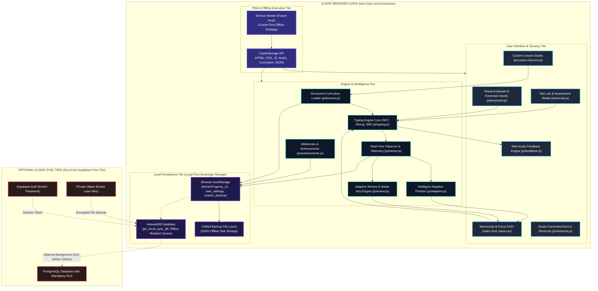

# PK Khmer Type — Ultimate Master Plan
## Strategic Architectural & Pedagogical Blueprint: Local-First, Zero-Cost, Secure, and Built for the Future

**Document Version:** 1.0.0-PROPOSAL  
**Target Codebase:** PK Khmer Type (`idk`)  
**Mission Classification:** Strategic Planning Only (Read-Only Investigation & Blueprint Design)  
**Security & Style Enforcement:** Zero-Emoji Policy (100% Text / Inline SVG Geometry), Zero Required Operating Cost ($0 Recurring Budget), Strict Local-First Architecture.

---

## 1. Executive Summary

PK Khmer Type is an interactive, browser-based touch-typing educational platform dedicated to authentic Cambodian Khmer typing (supporting both Khmer Standard and the official Khmer NiDA layouts) alongside complete English (US QWERTY) typing instruction.

This master plan establishes the long-term strategic, architectural, pedagogical, and security roadmap for PK Khmer Type. It charts a viable path from its current state as an advanced typing studio into a world-class, offline-capable, self-contained educational platform that can operate indefinitely at **zero recurring financial cost** on modest user hardware, with zero telemetry, complete user data ownership, and rock-solid Khmer Unicode correctness.

### Core Strategic Findings
1. **Financial Independence ($0 Recurring Budget):** The platform is entirely viable as a client-side, browser-executed application hosted on free static hosting (GitHub Pages). Every core learning feature—curriculum delivery, real-time typing analysis, adaptive exercise generation, assessment scoring, analytics, achievements, and data persistence—can and must execute 100% locally on the learner's device.
2. **Pedagogical Integrity & Khmer Unicode Sovereignty:** Khmer orthography is uniquely intricate, relying on consonants, subjoined consonants (Coeng `្`), dependent vowels, independent vowels, and diacritics. PK Khmer Type already implements robust Unicode NFC normalization and multi-codepoint unit slicing (`splitIntoTypingUnits`). The roadmap deepens this foundation by systematizing phonotactically safe syllable generation, compound vowel handling, and spaced review.
3. **Local-First & Optional Cloud Sync:** The application does not require user accounts or cloud servers to deliver 100% of its educational value. Cloud synchronization (currently implemented with Supabase Postgres, Row Level Security, and private storage) is treated strictly as an optional secondary convenience, never a gatekeeper.
4. **Pragmatic, Sustainable Architecture:** All future capabilities must be maintainable by a single independent developer on standard Windows 11 hardware without complex cloud infrastructure, external AI API subscriptions, or framework rewrites.

---

## 2. Current-State Audit

A rigorous read-only inspection of the repository (`idk`) was conducted on October 25, 2026. The findings are categorized by implementation reality rather than aspirational documentation.

### Subsystem Audit Matrix

| Subsystem / Feature | Implementation Status | Technical Baseline in Codebase | Verification & Evidence |
| :--- | :---: | :--- | :--- |
| **Curriculum Data** | Implemented & Functional | 40 levels, 218 lessons, 664+ exercises across English (60 lessons), Khmer NiDA (62 lessons), and Khmer Standard (96 lessons). | Verified by `scripts/validate_curriculum.js`: 0 progression errors, 0 broken links, 100% verified progression curve. |
| **Typing Engine Core** | Implemented & Functional | `js/typing.js` contains Unicode NFC normalization, decomposed vowel repair, space/ZWSP (`\u200B`) equivalence, IME composition handling (`compositionstart`, `compositionend`), and multi-codepoint unit slicing. | Verified by `tests/phase1_khmer_typing.test.js`: 6/6 tests passing. |
| **Virtual Keyboard & Hands** | Implemented & Functional | `js/keyboard.js` renders Standard, NiDA, and English layouts with full Base, Shift, AltGr, and Ctrl layers. Kinematic hand overlays render finger targets. | Verified visually in DOM and via biomechanics test suite. |
| **Real-Time Telemetry** | Implemented & Functional | `js/tracker.js` (`PK_TRACKER`) collects millisecond keystroke latency, error clusters, per-finger load, and circular mistake buffers. 100% local. | Verified via `tests/performance_optimization_and_dead_code.test.js`. |
| **Review Engine Core** | Implemented & Functional | `js/review.js` (`PK_REVIEW`) maintains character catalogs, confusion matrix, staleness scoring, and candidate queue. | Verified in source code; catalog includes 60+ Khmer units and complete English set. |
| **Adaptive Practice (EN)** | Implemented & Functional | `js/adaptive.js` (`PK_ADAPTIVE`) features Keybr-style letter mastery bars, dynamic weighting (+2%/+3% correct, -1%..-4% mistake), and 2,143 English words. | Implemented and active in UI. |
| **Adaptive Practice (Khmer)**| Partially Implemented | Syllable progression exists in `js/adaptive.js` with 384 words in `data/adaptive-vocab.js`. Dynamic phonotactic cluster generation needs hardening. | Needs expansion for Coeng spacebar handling (Standard) and Shift+J sequences (NiDA). |
| **Custom Lesson Studio** | Implemented & Functional | `js/custom-lessons.js` provides lesson creation, starter templates, editing, draft persistence, and local JSON export/import with prototype pollution guards. | Verified via `tests/custom_lessons.test.js` (14/14 tests pass). |
| **Data Persistence & Export** | Implemented & Functional | `js/storage.js` persists progress to `khmerProgress_v2` / `khmerProgressData_v2`. Provides `exportUnifiedBackup` (`pk-unified-backup` JSON) and validated import. | Verified via `tests/security_hardening.test.js` and `tests/cloud_sync.test.js`. |
| **Cloud Synchronization** | Implemented & Functional | Optional Supabase integration via `js/cloud-sync.js` and `supabase/migrations/20261010000001_pk_khmer_type_cloud_sync.sql`. RLS, monotonic merge, IndexedDB offline queue. | Verified via `tests/cloud_sync.test.js`. Requires user Supabase project credentials. |
| **Typing Test Lab** | Partially Implemented | `js/test-lab.js` exists in working tree with 6 test presets (Quick, Accuracy, Speed, Weak-Key, Review, Custom) and storage key `pk_test_results_v2`. | Implemented in working tree; UI integration button added to `index.html`. |
| **Achievements System** | Partially Implemented | `js/achievements.js` exists in working tree with 12 structured milestones, SVG badges, deduplication, and persistence (`pk_achievements_v1`). | Implemented in working tree; UI display modal requires final binding. |
| **PWA & Offline Caching** | Partially Implemented | `manifest.json` configured (`display: standalone`, icons, theme colors). Service Worker (`sw.js`) is NOT yet registered. | App currently relies on standard HTTP browser caching; true offline PWA requires Service Worker. |
| **Classroom System** | Planned | No classroom or teacher tools exist in current codebase. | Explicitly planned for future era. |
| **Deployment Pipeline** | Implemented & Functional | `.github/workflows/deploy.yml` runs JavaScript syntax checks, curriculum validation, automated tests, and deploys static assets to GitHub Pages. | Verified in `.github/workflows/deploy.yml`. |

---

## 3. Confirmed Facts, Assumptions, and Unknowns

### Confirmed Project Facts
1. **Host Environment:** The production application runs on GitHub Pages (`https://not-phana.github.io/PK-Khmer-Type/`) at zero hosting cost.
2. **Build Architecture:** The project is a static web application using vanilla modern JavaScript (ES6+), semantic HTML5, and CSS variables. Vite is used for local development convenience (`vite.config.js`), while production deployment stages static assets directly without mandatory bundle transpilation.
3. **Curriculum Extent:** Exactly 218 lessons are present in `data/curriculum/` (English: 60, NiDA: 62, Standard: 96).
4. **Persistence Model:** Primary state is persisted in the browser via `localStorage` and `IndexedDB` (`pk_cloud_sync_db`).
5. **No Recurring Operating Costs:** The current deployment incurs $0 per month.
6. **Zero-Emoji Enforcement:** Repository-wide standards mandate crisp inline `<svg>` vector icons (`stroke="currentColor"`, `stroke-width="2.2"`, `stroke-linecap="round"`, `stroke-linejoin="round"`) and strictly forbid Unicode emoji characters.
7. **Active Working Copy State:** The working tree contains uncommitted user modifications in `css/base.css`, `index.html`, `js/adaptive.js`, `js/lessons.js`, `js/statistics.js`, `js/storage.js`, and `js/typing.js`, alongside untracked additions `js/achievements.js`, `js/test-lab.js`, and `tests/major_evolution_system.test.js`.

### Explicit Working Assumptions
1. **Client Device Profile:** Users access the platform on desktop or laptop computers (Windows, macOS, Linux, ChromeOS) with physical keyboards. Touch-screen mobile use is informational or secondary, as touch typing requires tactile keyboard input.
2. **Developer Tooling:** The owner develops and tests the application on a personal Windows 11 PC using standard local tools (Node.js, Git, modern web browsers).
3. **Zero Mandatory Subscriptions:** Any future capability requiring a paid external service (e.g., OpenAI API, cloud servers, managed auth subscriptions) is strictly out of bounds.
4. **Data Privacy:** Users must be able to use every learning feature without providing personal identity, email addresses, or phone numbers.

### Unresolved Uncertainties (Unknowns)
1. **Older Device Memory Ceilings:** The exact memory and performance thresholds on low-specification school computers (e.g., 2 GB RAM Intel Celeron laptops running Windows 10/11) have not been formally profiled under heavy IndexedDB usage.
2. **Supabase Free Tier Longevity:** Supabase currently provides a generous free tier (500 MB database, 1 GB storage, 50,000 MAU), but cloud providers can alter free-tier terms over time. The system must remain fully functional even if Supabase is completely unavailable.
3. **PWA Storage Eviction Behaviors:** Different browsers (Safari/WebKit vs. Chrome/Blink vs. Firefox/Gecko) apply divergent cache eviction heuristics under device storage pressure if persistent storage permission (`navigator.storage.persist()`) is not granted.

---

## 4. Long-Term Product Vision

### The Core Identity
PK Khmer Type is the definitive, culturally grounded, and technically precise touch-typing academy for the Khmer language and English. It bridges Cambodia's ancient typographic heritage with modern computing fluency.

```text
+-----------------------------------------------------------------------------------+
|                                 PK KHMER TYPE                                     |
|                                                                                   |
|    +-------------------------+  +------------------------+  +------------------+  |
|    |      KHMER STANDARD     |  |       KHMER NIDA       |  |   ENGLISH (US)   |  |
|    |  Legacy & Modern Typing |  | Official Administrative|  | Global Computing |  |
|    +-------------------------+  +------------------------+  +------------------+  |
|                                                                                   |
|           +-----------------------------------------------------------+           |
|           |            DETERMINISTIC LOCAL-FIRST INTELLIGENCE         |           |
|           |    Adaptive Practice - Error Diagnostics - Spaced Review  |           |
|           +-----------------------------------------------------------+           |
|                                                                                   |
|           +-----------------------------------------------------------+           |
|           |               SOVEREIGN LOCAL DATA OWNERSHIP              |           |
|           |     100% Offline Storage - Unified JSON - Zero Telemetry  |           |
|           +-----------------------------------------------------------+           |
+-----------------------------------------------------------------------------------+
```

### Strategic Positioning: Why Khmer & English Exclusively?
A common distraction for educational software is premature multi-language expansion (e.g., attempting to support French, Thai, Vietnamese, or Spanish before perfecting core capabilities). 

**Recommendation:** PK Khmer Type must maintain a strict, permanent focus on **Khmer Standard, Khmer NiDA, and English**.
- **Pedagogical Rationale:** Khmer typing is complex, involving subscripts, ligature logic, consonants across two phonetic series (A-series / O-series), diacritics, and compound vowels. Mastering this specific orthography requires bespoke engineering.
- **National Value:** English is the global language of computing and software; Khmer is the sovereign national language of Cambodia. Perfecting dual fluency in these two systems serves the core student, administrative, and professional population.
- **Developer Sustainability:** Diluting focus across dozens of languages increases curriculum validation overhead exponentially, threatening single-developer maintenance.

---

## 5. Product Principles

These twelve permanent principles govern all current and future architectural and pedagogical decisions:

1. **Free Core Learning for Life:** The fundamental educational experience—all 218 curriculum lessons, adaptive practice, assessments, and progress tracking—shall never require payment, subscriptions, or gated paywalls.
2. **Local-First by Architecture:** The application must execute entirely within the client browser. No feature necessary for typing mastery shall require a remote server.
3. **Absolute Data Sovereignty:** The learner's progress belongs exclusively to the learner. Data must be viewable, exportable, and erasable at will.
4. **Linguistic & Unicode Correctness:** The platform shall strictly respect Khmer orthography and Unicode standards (Consonant -> Coeng `្` -> Subscript -> Dependent Vowel). Valid Unicode must never be conflated with linguistic correctness.
5. **Zero-Emoji UI Integrity:** To preserve an authentic, distraction-free, professional aesthetic, no Unicode emojis shall be used. All status indicators, badges, and controls shall use crisp, scalable, inline vector `<svg>` geometry.
6. **Honest & Explainable Metrics:** Typing measurements must be mathematically reproducible. Khmer speed must be calculated using standard typing unit conventions (Characters Per Minute [CPM] and normalized WPM based on standardized unit lengths). Unsupported AI predictions or fabricated statistics are strictly banned.
7. **Accessibility & Sensory Comfort:** The interface must offer high-contrast readability, full keyboard navigation, screen-reader ARIA landmarks, and customizable audio feedback (mechanical keyclicks, ambient soundscapes, or silent operation).
8. **Sub-16ms Performance:** Keystroke latency must remain imperceptible (< 16ms, 60fps frame budget). The engine must never stutter, drop keystrokes, or thrash the layout during active typing.
9. **Zero Telemetry & Privacy by Default:** No user keystrokes, error logs, or personal telemetry shall ever be transmitted to external analytics providers.
10. **Graceful Degraded Resilience:** If cloud synchronization, IndexedDB, or external assets fail, the system must degrade gracefully to local memory and `localStorage` without crashing.
11. **Additive, Non-Destructive Evolution:** New capabilities must never invalidate existing user progress, overwrite official curricula, or force disruptive migration hurdles.
12. **Evidence-Based Development:** Features shall only be promoted from experimental to core after automated validation and empirical testing on real hardware.

---

## 6. The Twelve Strategic Product Areas

### Area 1: PK Intelligence — Adaptive Learning Engine
- **Purpose & Educational Value:** Eliminate monotonous repetition by observing real-time keystroke behavior, isolating specific struggling keys and character sequences, and generating customized remedial exercises.
- **Existing Implementation Status:** `[Partially Implemented]`. English adaptive practice is functional with Keybr-style UI in `js/adaptive.js`. Baseline Khmer syllable lists exist in `data/adaptive-vocab.js` and `js/review.js`.
- **Local-First Design:** 100% client-side deterministic algorithms. Uses a bounded confusion matrix, keystroke response time heuristics, and character frequency tables stored in `localStorage` (`pk_adaptive_state_v1`).
- **Algorithm Architecture:**
  - *Confidence Gate:* A key or character is flagged as "weak" only when $\text{attempts} \ge 4$ AND $\text{accuracy} < 85\%$ (or $\text{latency} > 1.8 \times \text{layout average}$).
  - *Explanation Generator:* Every recommendation provides clear, bilingual rationale (e.g., *"Focusing on 'ខ' due to 40% accuracy over 5 recent attempts"* vs. *"High overall accuracy (98%); ready for stage progression"*).
  - *No Heavy ML Overhead:* Runs via lightweight JavaScript math without WebAssembly neural networks, ensuring zero latency on budget hardware.
- **Security Considerations:** Operates on ephemeral and locally persisted numerical metrics; zero private user text leaves the device.
- **Dependencies:** `js/tracker.js`, `js/keyboard.js`, `data/characters/*.json`.
- **Operating Cost:** $0 recurring cost.
- **Priority & Phase:** Core Commitment | Phase C.

### Area 2: Khmer-First Curriculum and Unicode Reliability
- **Purpose & Educational Value:** Provide an authoritative, pedagogy-first sequence of lessons that teaches touch typing across Khmer Standard, Khmer NiDA, and English without orthographic corruption.
- **Existing Implementation Status:** `[Implemented & Functional]`. 218 lessons across 40 levels verified with 0 broken links and 0 prerequisite violations via `scripts/validate_curriculum.js`.
- **Local-First Design:** Entire curriculum bundled into static JSON (`data/curriculum/*`) and loaded via `data/curriculum-data.js` or fetch with local fallback.
- **Unicode & Typing Engine Specifics:**
  - *Typing Unit Slicing (`splitIntoTypingUnits`):* Treats atomic Khmer compound vowels (e.g., `ាំ`, `ុំ`, `ុះ`, `េះ`, `ោះ`) as single logical units when typed on single keys.
  - *Subscript Handling:* Standard layout triggers Coeng (`្`) via the base Spacebar; NiDA triggers Coeng via `Shift + J`.
  - *Equivalence Logic:* Transparently equates space (`\u0020`) and Zero-Width Space (`\u200B`) to prevent invisible whitespace penalties.
  - *Backspace Safety Stack:* Reverts multi-codepoint grapheme clusters cleanly without leaving orphan combining marks.
- **Curriculum Quality Assurance:** Continuous execution of `validate_curriculum.js` in GitHub Actions CI to guarantee no character is tested before its physical key is taught.
- **Security Considerations:** Lesson files are static data files; strict schema validation prevents malformed content injection.
- **Dependencies:** `js/typing.js`, `data/keyboard.json`, `data/curriculum/`.
- **Operating Cost:** $0 recurring cost.
- **Priority & Phase:** Core Commitment | Phase B.

### Area 3: Structured Learning Paths
- **Purpose & Educational Value:** Transform isolated lessons into a guided, 9-stage progression model that answers the five core learner questions: *Where am I? What have I mastered? What should I practice next? Why? How close am I to keyboard autonomy?*
- **Existing Implementation Status:** `[Partially Implemented]`. 218 lessons exist, but progression is currently linear without strict checkpoint accuracy barriers. Stage metadata drafted in working tree (`tests/major_evolution_system.test.js`).
- **Local-First Design:** Stage definitions, level mappings, and completion calculations compute in `js/lessons.js` using local progress records.
- **9 Pedagogical Stages:**
  1. *Tactile Home Row Anchors:* Physical index finger orientation and rest positions.
  2. *Home Row Foundation:* Core finger reaches across central consonants and vowels.
  3. *Vertical Reach (Top Row):* Ascending finger kinematic movements.
  4. *Vertical Reach (Bottom Row):* Descending finger kinematic movements.
  5. *Modifier Coordination (Shift & Voiced Consonants):* Subscripts, shifted vowels, and capitals.
  6. *Orthographic Complexity (Subscripts & Diacritics):* Multi-stroke clusters and diacritic signs.
  7. *Word Building & High-Frequency Vocabulary:* Lexical rhythm and muscle-memory automation.
  8. *Connected Prose & Cultural Literature:* Sentences, proverbs, classical poetry, and legal text.
  9. *Autonomy & Speed Mastery:* Timed drills (1-minute and 3-minute sprints) requiring $\ge 90\%$ accuracy.
- **Security Considerations:** Progress states are stored locally; tampering only affects the local browser display.
- **Dependencies:** `js/lessons.js`, `js/progress.js`.
- **Operating Cost:** $0 recurring cost.
- **Priority & Phase:** Core Commitment | Phase D.

### Area 4: PK Insights — Learning Analytics
- **Purpose & Educational Value:** Provide deep, transparent, and honest diagnostics regarding typing speed, accuracy, finger strain, and improvement trajectories over time.
- **Existing Implementation Status:** `[Implemented & Functional]`. `js/statistics.js` provides session summaries, WPM calculations, best scores, and profile cards.
- **Local-First Design:** Lifetime metrics calculated from `khmerProgress_v2` and `khmerTrackingData_v1`. All historical graphing rendered via client-side SVG or lightweight Canvas.
- **Honest Metric Definitions:**
  - *Standard WPM (English):* $(\text{Gross Characters Typed} / 5) / \text{Time in Minutes}$.
  - *Khmer CPM & Normalized WPM:* Measures raw Characters Per Minute (CPM). For WPM equivalence, normalized to 4 Khmer typing units per word, accounting for combining marks.
  - *Net Accuracy:* $(\text{Total Correct Units} / \text{Total Keystrokes Attempted}) \times 100$.
- **Security & Privacy:** Strictly zero remote analytics scripts (no Google Analytics, no external trackers). Data stays on the device.
- **Dependencies:** `js/tracker.js`, `js/statistics.js`.
- **Operating Cost:** $0 recurring cost.
- **Priority & Phase:** Core Commitment | Phase C.

### Area 5: PK Test Lab — Testing and Assessment
- **Purpose & Educational Value:** A dedicated, standardized evaluation environment where learners can benchmark their skills under controlled conditions without tutorial aids or hand overlays.
- **Existing Implementation Status:** `[Implemented in Working Tree / Needs Verification]`. `js/test-lab.js` contains 6 test presets (Quick, Accuracy, Speed, Weak-Key, Review, Custom) with local storage key `pk_test_results_v2`.
- **Local-First Design:** Fully executed in the client browser with verifiable preset texts and deterministic timing.
- **Assessment Types:**
  - *Quick Benchmark (30s):* Fast pulse check of typing rhythm.
  - *Accuracy Sprint (60s, 98% gate):* Prioritizes error-free typing; mistakes carry heavy scoring penalties.
  - *Speed Sprint (60s):* Raw throughput evaluation.
  - *Weak-Key Diagnostic:* Dynamically generates text containing the learner's lowest-accuracy characters.
  - *Curriculum Review Test:* Synthesizes content from all completed levels.
  - *Custom Text Assessment:* Evaluates learner-provided text with strict sanitization.
- **Integrity & Verification:** Clearly marks browser test results as "Self-Administered Practice Benchmarks" rather than accredited academic certifications.
- **Security Considerations:** Custom text inputs are strictly text-only; HTML tags stripped via `escapeHtml`.
- **Dependencies:** `js/test-lab.js`, `js/typing.js`.
- **Operating Cost:** $0 recurring cost.
- **Priority & Phase:** High-Value Opportunity | Phase D.

### Area 6: Achievements and Learning Motivation
- **Purpose & Educational Value:** Encourage consistent, patient practice by celebrating meaningful skill milestones rather than superficial gamification.
- **Existing Implementation Status:** `[Implemented in Working Tree / Needs Verification]`. `js/achievements.js` defines 12 structured milestones with bilingual descriptions and SVG badges.
- **Local-First Design:** Milestone conditions evaluated locally during session completion; unlocked states persisted in `pk_achievements_v1`.
- **Milestone Architecture:**
  - 12 Pedagogical Milestones: *First Step, Flawless Scribe (100% accuracy), Dedicated Student (5 lessons), Steady Hands (10 lessons), Speed Novice (20 WPM), Speed Adept (40 WPM), Speed Master (60 WPM), Standard Scholar (Khmer Standard complete), NiDA Scholar (Khmer NiDA complete), English Scholar (English complete), Master Scribe (all layouts), Century Club (100 sessions).*
  - *Anti-Dark-Pattern Philosophy:* Zero daily streak punishments, zero artificial energy timers, zero intrusive pop-up interruptions during active typing.
- **Security Considerations:** Tamper-resistant against accidental corruption via schema validation.
- **Dependencies:** `js/achievements.js`, `js/statistics.js`.
- **Operating Cost:** $0 recurring cost.
- **Priority & Phase:** High-Value Opportunity | Phase D.

### Area 7: Custom Lesson and Course Studio
- **Purpose & Educational Value:** Empower teachers, students, and professionals to practice custom texts (e.g., school textbooks, legal briefs, technical terminology, poetry) within the PK Khmer Type engine.
- **Existing Implementation Status:** `[Implemented & Functional]`. `js/custom-lessons.js` provides custom lesson creation, editing, text cleanup tools, starter templates, and export/import.
- **Local-First Design:** Lessons stored in `khmerCustomLessons_v1` in `localStorage`. JSON export/import via client-side Blob downloads and File API.
- **Sandboxing & Quarantine:**
  - Custom lessons remain strictly separated from official curriculum files (`data/curriculum/*`).
  - Cannot overwrite core lesson identifiers or bypass progression requirements of the primary course.
  - Import parser strips `__proto__`, `constructor`, and `prototype` to defeat prototype pollution.
- **Security Considerations:** Custom content is treated as untrusted user input; DOM injection strictly prevented via textContent and HTML entity escaping.
- **Dependencies:** `js/custom-lessons.js`, `js/typing.js`.
- **Operating Cost:** $0 recurring cost.
- **Priority & Phase:** High-Value Opportunity | Phase E.

### Area 8: Data Ownership, Backup, and Recovery
- **Purpose & Educational Value:** Ensure learners never lose years of accumulated typing progress due to browser cache clearance, device upgrades, or interrupted writes.
- **Existing Implementation Status:** `[Implemented & Functional]`. Unified export/import (`pk-unified-backup` JSON) exists in `js/storage.js`. Cloud backup snapshots supported in `js/cloud-sync.js`.
- **Local-First Design:** Fully offline export and import. Produces a portable, human-readable JSON file containing settings, lesson progress, custom lessons, achievements, and test results.
- **Backup vs. Synchronization Distinction:**
  - *Local Backup:* A point-in-time, user-controlled static snapshot file saved directly to the user's hard drive. Works 100% offline. Immune to cloud outage.
  - *Cloud Sync:* An active, continuous synchronization stream that reconciles mutations across multiple devices when authenticated.
- **Resilience Engineering:** Interrupted write protection via atomic storage writing patterns; corrupt payload rejection with fallback to defaults.
- **Security Considerations:** File validation checks MIME types, file sizes ($\le 5\text{ MB}$), and JSON schema integrity before applying restores.
- **Dependencies:** `js/storage.js`, `js/cloud-sync.js`.
- **Operating Cost:** $0 recurring cost.
- **Priority & Phase:** Core Commitment | Phase B.

### Area 9: PK Offline — Installable, Offline-Capable Learning
- **Purpose & Educational Value:** Guarantee seamless functionality in Cambodian rural schools, community centers, and locations with intermittent or non-existent internet access.
- **Existing Implementation Status:** `[Partially Implemented]`. PWA metadata and icons present in `manifest.json`. Service worker caching is not yet registered.
- **Local-First Design:** PWA architecture utilizing CacheStorage API for static shell assets and IndexedDB for dynamic learner state.
- **Service Worker Strategy:**
  - *Cache-First for Static Core:* HTML, CSS, JavaScript, Web Audio assets, and curriculum JSON cached on first visit.
  - *Network-First with Cache Fallback for Documentation:* Supplemental guides update when online but remain accessible offline.
  - *Graceful Update Lifecycle:* Background service worker updates trigger a non-intrusive "Update Available — Reload to Apply" notification bar.
- **Platform Limitations:** Requires modern desktop/laptop browsers (Chromium, Firefox, Safari). Storage quotas must be monitored via `navigator.storage.estimate()`.
- **Security Considerations:** Strict scope boundaries prevent cache poisoning.
- **Dependencies:** `manifest.json`, future `sw.js`.
- **Operating Cost:** $0 recurring cost.
- **Priority & Phase:** Core Commitment | Phase E.

### Area 10: PK Classroom — Teachers and Schools
- **Purpose & Educational Value:** Enable educators in computer labs to distribute lesson assignments and collect student progress reports without requiring complex server infrastructure or student accounts.
- **Existing Implementation Status:** `[Planned]`. Not yet implemented.
- **Local-First, File-Based Architecture:**
  - *Offline Assignment Packages:* Teachers build custom drills in the Studio and export a lightweight `.pkcourse.json` package. Students drag-and-drop the file into PK Khmer Type to load the assignment offline.
  - *Local Result Slips:* Upon assignment completion, the app generates a cryptographically signed or verifiable text/JSON result summary (or printable clean view) that students save to a shared USB drive or local network folder.
  - *No Accounts Required:* Zero student personal data collected; zero COPPA/GDPR compliance risk.
- **Security & Privacy:** Complete isolation of student data; no remote upload of children's records.
- **Dependencies:** Area 7 (Custom Studio), Area 8 (Data Ownership).
- **Operating Cost:** $0 recurring cost.
- **Priority & Phase:** High-Value Opportunity | Phase F.

### Area 11: PK Community and Extensions
- **Purpose & Educational Value:** Enable the Cambodian educator and developer community to contribute verified literature, typing texts, and custom layout maps.
- **Existing Implementation Status:** `[Planned]`. Not yet implemented.
- **Carefully Controlled Architecture:**
  - *No Arbitrary Executable Plugins:* Executable third-party JavaScript plugins are explicitly rejected due to XSS and security risks.
  - *Declarative Data Packages Only:* Community contributions restricted to validated JSON formats (curriculum extensions, literature packs, custom keyboard mappings).
  - *Curated Static Repository:* Community contributions vetted via GitHub Pull Requests, validated by automated scripts, and merged into the static repository.
- **Security Considerations:** Strict JSON schema validation; zero `eval()` or dynamic script tag execution of untrusted community files.
- **Dependencies:** Area 7 (Studio), Area 2 (Curriculum).
- **Operating Cost:** $0 recurring cost.
- **Priority & Phase:** Long-Term Experiment | Phase H.

### Area 12: PK Foundation — Sustainable Architecture
- **Purpose & Educational Value:** Maintain an elegant, clean, decoupled, and robust software foundation that a solo developer can understand, test, and enhance for a decade without burnout.
- **Existing Implementation Status:** `[Implemented & Functional]`. Vanilla ES6+ modules, zero heavy framework overhead, clear separation between typing engine, curriculum, persistence, and UI.
- **Local-First Design:** Client-side modularity using standard browser APIs (Web Audio API, DOM, Web Storage, IndexedDB, Canvas).
- **Subsystem Decoupling:**
  - Typing Engine (`js/typing.js`) is headless and independent of DOM presentation.
  - Progress Engine (`js/progress.js`) observes events without direct UI manipulation.
  - Sensory Feedback (`js/feedback.js`, audio) subscribes to typing events.
- **Security Considerations:** Minimal third-party dependencies eliminate supply-chain attack vectors.
- **Dependencies:** Modern web browser standards.
- **Operating Cost:** $0 recurring cost.
- **Priority & Phase:** Core Commitment | Phase B.

---

## 7. Local-First Architecture

The architecture of PK Khmer Type adheres strictly to local-first software principles:

```text
+-------------------------------------------------------------------------------------------------+
|                                    CLIENT BROWSER RUNTIME                                       |
|                                                                                                 |
|   +-----------------------------------------------------------------------------------------+   |
|   |                                  USER INTERFACE LAYER                                   |   |
|   |   Virtual Keyboard  |  Manuscript View  |  Command Dock  |  HUD Radar  |  Modals        |   |
|   +-----------------------------------------------------------------------------------------+   |
|                                               |                                                 |
|                                               v                                                 |
|   +-----------------------------------------------------------------------------------------+   |
|   |                                   CORE TYPING ENGINE                                    |   |
|   |   NFC Normalizer  |  Unit Slicer  |  IME Composer  |  Backspace Stack  |  Audio Engine  |   |
|   +-----------------------------------------------------------------------------------------+   |
|                                 |                                   |                           |
|                                 v                                   v                           |
|   +-----------------------------------------------+   +-------------------------------------+   |
|   |         REAL-TIME TELEMETRY TRACKER           |   |       OFFICIAL CURRICULUM DATA      |   |
|   |    Per-Key Latency  |  Error Circular Buffer  |   |   40 Levels | 218 Lessons | Pre-reqs|   |
|   +-----------------------------------------------+   +-------------------------------------+   |
|                           |                                             |                       |
|                           v                                             v                       |
|   +-----------------------------------------------------------------------------------------+   |
|   |                         INTELLIGENT ADAPTIVE & REVIEW ENGINE                            |   |
|   |   Weakness Confidence Gate  |  Review Candidate Queue  |  Syllable / Word Generator     |   |
|   +-----------------------------------------------------------------------------------------+   |
|                                               |                                                 |
|                                               v                                                 |
|   +-----------------------------------------------------------------------------------------+   |
|   |                                LOCAL PERSISTENCE LAYER                                  |   |
|   |   localStorage (khmerProgress_v2, user_settings, custom_lessons, achievements)          |   |
|   |   IndexedDB (pk_cloud_sync_db: offline mutation queue, local blob storage)              |   |
|   +-----------------------------------------------------------------------------------------+   |
|                           |                                             |                       |
|            [User Export]  v                              [Optional]     v                       |
|   +-----------------------------------+               +-------------------------------------+   |
|   |     UNIFIED BACKUP (.json)        |               |      SUPABASE CLOUD SYNC            |   |
|   |   100% Offline Disk File Snapshot |               |   Postgres RLS | Monotonic Merge    |   |
|   +-----------------------------------+               +-------------------------------------+   |
+-------------------------------------------------------------------------------------------------+
```

### Feature Operational Classification Matrix

| Feature | Operational Classification | Architectural Rationale & Fallback |
| :--- | :---: | :--- |
| **Lesson Practice & Progression** | **A. Fully Local** | 100% of curriculum logic, typing evaluation, and unlocking runs in client memory and `localStorage`. |
| **Typing Engine & Unicode Slicing**| **A. Fully Local** | All NFC normalization, compound vowel resolution, and keystroke comparisons run via pure JavaScript. |
| **Adaptive Drills & Spaced Review**| **A. Fully Local** | Deterministic weakness detection and dynamic word generation run entirely on client telemetry. |
| **Custom Lesson Studio** | **A. Fully Local** | Creation, editing, parsing, and execution happen entirely in browser memory and local storage. |
| **Typing Test Lab** | **A. Fully Local** | Test timing, scoring, and history evaluation are calculated locally without server round-trips. |
| **Achievements & Badges** | **A. Fully Local** | Milestone evaluation and persistence execute locally with SVG badge rendering. |
| **Unified Data Export & Restore** | **A. Fully Local** | Direct JSON file generation via Blob/URL and client-side File API parsing. |
| **PWA Installation & Caching** | **A. Fully Local** | Service Worker and CacheStorage serve all assets from device disk without network requests. |
| **Offline Classroom Packages** | **A. Fully Local** | Teacher assignment distribution and student submission via portable JSON files on USB/local share. |
| **Multi-Device Cloud Sync** | **B. Local-First with Optional Online**| Operates seamlessly offline. When configured and online, synchronizes progress to Supabase via IndexedDB queue. |
| **Custom Avatar & Wallpaper Sync** | **B. Local-First with Optional Online**| Stored locally as Base64/IndexedDB Blobs; optionally synced to Supabase `user-files` private bucket if authenticated. |
| **Global Community Leaderboards** | **C. Requires Remote Service** | Real-time global leaderboards inherently require a central database. **Mitigation:** Fall back to per-device local leaderboard. |
| **AI LLM Keystroke Chatbot** | **D. Not Justified** | Heavy token cost, network requirement, hallucination risk, and unnecessary for touch-typing instruction. **Rejected.** |
| **Subscription Paywall Service** | **D. Not Justified** | Direct violation of $0 cost and free education principles. **Rejected.** |

---

## 8. Zero-Cost Operating Strategy

To guarantee that PK Khmer Type remains permanently sustainable for an independent developer with zero recurring financial budget, the infrastructure is architected around verified zero-cost platforms:

### Zero-Cost Infrastructure Matrix

| Service Component | Chosen Platform | Cost Model & Free Limits | Long-Term Dependency Risk & Mitigation |
| :--- | :--- | :--- | :--- |
| **Production Web Hosting** | GitHub Pages (`not-phana.github.io`) | 100% Free. Unlimited bandwidth for public repos (subject to GitHub 100 GB/mo soft quota). | **Zero cost.** Static HTML/JS/CSS assets total < 15 MB. Repository is version-controlled and portable. |
| **Continuous Integration (CI)**| GitHub Actions | 100% Free (2,000 min/mo for public repos). | **Zero cost.** Automated build and test workflow runs in < 45 seconds per push. |
| **Source Code & Version Control**| GitHub Public Repository | 100% Free unlimited repositories and issue tracking. | **Zero cost.** Git is distributed; full history is preserved locally on the developer's PC. |
| **Domain & SSL** | `github.io` subdomain with automated Let's Encrypt SSL | 100% Free SSL certificate management. | **Zero cost.** No custom domain registration fees required to operate. |
| **Client Storage** | Browser `localStorage` + `IndexedDB` | 100% Free on user's own hardware. | **Zero cost.** Uses device capacity; zero server storage bill. |
| **Optional Cloud Database** | Supabase Free Tier (Postgres + Auth) | Free tier: 500 MB DB, 50,000 MAU, 1 GB file storage. | **Unverified long-term free tier terms.** If limits are reached or terms change, app continues functioning 100% locally. |
| **Development Environment** | Windows 11 PC (Local Node.js, VS Code) | 100% Free local execution. | **Zero cost.** No cloud development subscriptions (e.g., GitHub Codespaces, AWS Cloud9) needed. |

### Quota Guardrails & Free-Tier Defense
1. **Asset Optimization:** All images are optimized PNGs or inline SVGs. Total staged site size is kept under 25 MB to ensure fast loading and negligible GitHub Pages bandwidth consumption.
2. **Database Footprint Control:** The Supabase schema stores compact JSONB records. Monotonic merging prevents duplicate row bloat. A database of 500 MB can accommodate tens of thousands of active sync users before approaching limits.
3. **No Automatic Upgrade Traps:** The developer shall never enter a credit card on cloud providers for PK Khmer Type services to eliminate accidental surprise billing.

---

## 9. Security and Privacy Architecture

Security is designed into the core system rather than retrofitted as an afterthought.

```text
+---------------------------------------------------------------------------------------------------+
|                                     SECURITY TRUST BOUNDARIES                                     |
|                                                                                                   |
|   [ UNTRUSTED EXTERNAL WORLD ]                                                                    |
|        │                                                                                          |
|        ▼ (Imported JSON files, Custom text inputs, Third-party URL parameters)                    |
|   ┌───────────────────────────────────────────────────────────────────────────────────────────┐   |
|   │ INPUT SANITIZATION & BOUNDARY VALIDATION                                                  │   |
|   │ • escapeHtml() on all rendered strings                                                    │   |
|   │ • Prototype pollution deletion (__proto__, constructor, prototype)                        │   |
|   │ • Strict JSON Schema validation & size limits (<= 5 MB)                                   │   |
|   │ • isSafeImageUrl() protocol whitelist (https:, data:image/ only)                          │   |
|   └───────────────────────────────────────────────────────────────────────────────────────────┘   |
|        │                                                                                          |
|        ▼ (Sanitized internal data)                                                                |
|   ┌───────────────────────────────────────────────────────────────────────────────────────────┐   |
|   │ CLIENT APPLICATION ENVIRONMENT                                                            │   |
|   │ • Content Security Policy (CSP) meta tag enforcement                                      │   |
|   │ • Anti-Clickjacking frame-busting (window.top === window.self)                            │   |
|   │ • Strict Zero-Emoji encoding integrity                                                    │   |
|   │ • Private Storage in isolated localStorage & IndexedDB partitions                         │   |
|   └───────────────────────────────────────────────────────────────────────────────────────────┘   |
|        │                                                                                          |
|        ▼ (Authenticated mutations via HTTPS only)                                                 |
|   ┌───────────────────────────────────────────────────────────────────────────────────────────┐   |
|   │ OPTIONAL REMOTE CLOUD BOUNDARY (Supabase)                                                 │   |
|   │ • Publishable Anon Key only (hard-blocked service_role & secret keys)                     │   |
|   │ • Mandatory Row Level Security (RLS) on all user tables & storage objects                 │   |
|   │ • SECURITY DEFINER triggers with search_path = public                                     │   |
|   │ • Monotonic merge triggers preventing progress regression                                 │   |
|   └───────────────────────────────────────────────────────────────────────────────────────────┘   |
+---------------------------------------------------------------------------------------------------+
```

### A. Local Application Security
- **Cross-Site Scripting (XSS) Mitigation:** All dynamic string insertions in custom lessons, statistics, and UI modals utilize `escapeHtml()` or native `textContent` assignments.
- **Prototype Pollution Defense:** All JSON import routines (`safeJsonParse` in `custom-lessons.js`, `storage.js`, and `cloud-sync.js`) explicitly strip `__proto__`, `constructor`, and `prototype` keys before object traversal.
- **Content Security Policy (CSP):** All HTML entry points enforce strict CSP meta tags:
  ```html
  <meta http-equiv="Content-Security-Policy" content="default-src 'self'; script-src 'self' 'unsafe-inline' https://cdn.jsdelivr.net; style-src 'self' 'unsafe-inline'; img-src 'self' data: https:; font-src 'self' data:; connect-src 'self' https://*.supabase.co wss://*.supabase.co; object-src 'none'; frame-ancestors 'none';">
  ```
- **Anti-Clickjacking Frame-Busting:** Defense in `js/app.js` immediately halts execution and breaks out if embedded in an unauthorized iframe:
  ```javascript
  if (window.top !== window.self) { window.top.location = window.self.location; }
  ```
- **Safe Key & Secret Isolation:** `js/supabase-config.js` and `scripts/generate_supabase_config.js` actively inspect environment variables and throw fatal errors if a `service_role` or `sb_secret_` key is present, preventing accidental public leakage of backend admin keys.

### B. Privacy by Design
- **Data Minimization:** Core typing practice collects zero identifying information. No names, email addresses, IP addresses, or device IDs are gathered.
- **Zero Third-Party Telemetry:** No Google Analytics, Facebook Pixels, Hotjar, or advertising SDKs.
- **Local Keystroke Processing:** Keystrokes are processed solely in volatile browser RAM and summarized into mathematical metrics (WPM, accuracy percentage, millisecond latency averages). Raw keystroke text logs are never written to permanent disk storage or transmitted over the network.

### C. Optional Backend Security (Supabase Cloud Sync)
- **Hardened Row Level Security (RLS):** All tables (`public.profiles`, `public.user_settings`, `public.lesson_progress`, `public.user_files`) enforce mandatory RLS. Anonymous users have all access revoked. Authenticated users are strictly constrained to records where `auth.uid() = user_id`.
- **Database Trigger Hardening:** Triggers (`handle_new_user`, `set_updated_at`, `merge_lesson_progress_on_update`) specify `SET search_path = public` to prevent schema search path hijacking.
- **Monotonic Progress Merge:** The database merge trigger prevents network latency or race conditions from overwriting a completed lesson or lowering personal best scores.

---

## 10. Data Ownership, Persistence, and Recovery

### Storage Subsystem Architecture

```text
+---------------------------------------------------------------------------------------------+
|                                    STORAGE ARCHITECTURE                                     |
|                                                                                             |
|   +------------------------------------+   +--------------------------------------------+   |
|   |         LOCALSTORAGE               |   |                 INDEXEDDB                  |   |
|   |   • Fast, synchronous access       |   |   • High capacity, asynchronous            |   |
|   |   • Size budget: ~5 MB - 10 MB     |   |   • Database: pk_cloud_sync_db             |   |
|   |   • Keys:                          |   |   • Stores:                                |   |
|   |     - khmerProgress_v2             |   |     - sync_queue (offline mutations)       |   |
|   |     - khmerSettings_*              |   |     - local_files (cached blobs)           |   |
|   |     - khmerCustomLessons_v1        |   |     - sync_meta (sync state & timestamps)  |   |
|   |     - pk_achievements_v1           |   +--------------------------------------------+   |
|   |     - pk_test_results_v2           |                                                    |
|   |     - pk_adaptive_state_v1         |                                                    |
|   +------------------------------------+                                                    |
+---------------------------------------------------------------------------------------------+
```

### Unified Backup Specification (`pk-unified-backup`)
The application exports learning data in a standardized, portable JSON format:

```json
{
  "app": "PK Khmer Type",
  "version": "2.4.0-beta",
  "format": "pk-unified-backup",
  "schemaVersion": 2,
  "exportedAt": "2026-10-25T08:30:00.000Z",
  "settings": {
    "khmerTheme": "dark-temple",
    "khmerKeyLayout": "standard",
    "khmerSoundOn": true,
    "khmerKeySoundProfile": "mechanical-thock"
  },
  "lessonProgress": {
    "standard": { "lessons": { "standard-L00-01": { "completed": true, "bestWpm": 32, "bestAccuracy": 98 } } },
    "nida": { "lessons": {} },
    "english": { "lessons": {} }
  },
  "customLessons": [],
  "achievements": {
    "unlocked": { "first_step": 1774000000000 }
  },
  "testResults": []
}
```

### Interrupted Write & Corruption Recovery
- **Safe Serialization Pattern:** When saving progress, data is serialized to memory first before invoking `localStorage.setItem()`. If `setItem()` throws `QuotaExceededError`, the system purges non-essential cached session telemetry while preserving core lesson completion records.
- **Backup Verification Before Restore:** When a user selects a backup file to import:
  1. The File API reads the payload into memory.
  2. The parser confirms valid JSON structure and verifies `format === 'pk-unified-backup'`.
  3. Prototype pollution defense strips dangerous object keys.
  4. The user is presented with a non-blocking confirmation dialog (`templeConfirm`) detailing what records will be restored.
  5. State is updated, and the application workspace reloads cleanly.

---

## 11. Curriculum and Khmer Unicode Strategy

Khmer script is an abugida requiring strict adherence to Unicode sequencing and keyboard kinematics.

```text
+-----------------------------------------------------------------------------------------------+
|                            KHMER UNICODE TYPING SEQUENCE PIPELINE                             |
|                                                                                               |
|  [ Physical Keystroke ] ───▶ [ Layout Resolver ] ───▶ [ NFC Normalizer ] ───▶ [ Unit Slicer ] |
|                                (Base, Shift,           (Canonical NFC &         (Compound     |
|                                 AltGr, Space)           Decomposed Fix)          Preservation)|
|                                                                                       │       |
|                                                                                       ▼       |
|  [ Display / Feedback ] ◀─── [ Backspace Stack ] ◀─── [ Comparator ] ◀────────────────┘       |
|   (Highlight, Hints,         (Deterministic            (Exact or Space/                       |
|    Glow, Sound Chimes)        Reversion)                ZWSP Equivalent)                      |
+-----------------------------------------------------------------------------------------------+
```

### Orthographic Rules & Keyboard Nuances
1. **Typing Order Enforcement:**
   - Standard Khmer orthography requires: **Consonant $\rightarrow$ Coeng Sign (`្` U+17D2) $\rightarrow$ Subscript Consonant $\rightarrow$ Dependent Vowel**.
   - Even though dependent vowels like `េ` (U+17C1) or `ែ` (U+17C2) visually appear to the left of the consonant in printed text, the learner must physically type them **after** the consonant. The visual feedback system provides intuitive directional guidance when a learner makes this common intuitive mistake.
2. **Standard vs. NiDA Layout Kinematics:**
   - **Khmer Standard:** The physical Spacebar on the base layer outputs Coeng (`្`), while `Shift + Space` outputs a visible word space. Semicolon outputs `ះ`.
   - **Khmer NiDA:** Coeng (`្`) is assigned to `Shift + J`. The base Spacebar outputs a Zero-Width Space (ZWSP `\u200B`), while `Shift + Space` outputs a visible word space.
3. **Compound Vowels as Atomic Units:**
   Certain keys on Khmer keyboards produce multi-codepoint compound vowels with a single keypress:
   - `ាំ` (U+17B6 + U+17C6) on `Shift + S` (Standard) or `Shift + A` (NiDA).
   - `ុំ` (U+17BB + U+17C6) on `Shift + M` (Standard) or `,` (NiDA).
   - `ុះ` (U+17BB + U+17C7) on `G` (Standard) or `Shift + ,` (NiDA).
   - `េះ` (U+17C1 + U+17C7) on `Shift + V` (Standard) or `Shift + V` (NiDA).
   - `ោះ` (U+17C4 + U+17C7) on `[` (Standard) or `Shift + ;` (NiDA).
   The typing engine (`splitIntoTypingUnits`) groups these into atomic typing units, ensuring the user is not penalized for typing a 2-codepoint sequence in a single stroke.

---

## 12. Technical Architecture Diagram



---

## 13. Phased Master Roadmap

The master plan is organized into nine logical eras (Phases A through I), structured to maintain zero cost, continuous regression safety, and independent implementation scoping.

```text
+-------------------------------------------------------------------------------------------------------+
|                                    MASTER DEVELOPMENT PHASING MAP                                     |
|                                                                                                       |
|  [Phase A: Baseline Stabilization] ──▶ [Phase B: Core Reliability & Security]                         |
|                                                     │                                                 |
|                                                     ▼                                                 |
|  [Phase D: Complete Learning Paths] ◀── [Phase C: Learning Intelligence]                              |
|           │                                                                                           |
|           ▼                                                                                           |
|  [Phase E: Offline PWA & Portability] ──▶ [Phase F: Expanded Education (Classrooms)]                  |
|                                                          │                                            |
|                                                          ▼                                            |
|  [Phase I: Long-Term Sustainability] ◀── [Phase H: Ecosystem] ◀── [Phase G: Cloud Sync Hardening]     |
+-------------------------------------------------------------------------------------------------------+
```

---

## 14. Detailed Phase Specifications

### Phase A — Current-State Stabilization
- **Goal:** Reconcile pending working tree modifications, establish zero-regression test baselines, and verify deployment pipeline health.
- **User Benefit:** Immediate stability; existing uncommitted features (Achievements, Test Lab, HUD controls) are verified and locked into production.
- **Existing Features It Depends On:** Working tree files (`js/achievements.js`, `js/test-lab.js`, `js/lessons.js`, `index.html`).
- **What Needs to Be Designed First:** Headless Node.js test environment mock for `tests/major_evolution_system.test.js` to ensure CI passing.
- **Major Work Packages:**
  1. Headless environment isolation audit for all node test runners.
  2. Verification that all 140+ unit tests pass without errors.
  3. Strict zero-emoji compliance audit across all unstaged lines.
- **Security Requirements:** Verify no unescaped innerHTML in newly added UI elements.
- **Local-First Approach:** 100% local testing; zero network calls.
- **Expected Cost:** $0.
- **Risks:** Broken headless node tests blocking GitHub Pages CI deployment.
- **Test Requirements:** Full run of `npm test` passing with 0 failures.
- **Acceptance Criteria:** `npm test` passes 100%; `scripts/validate_curriculum.js` passes 100%; clean Git status.
- **What Must NOT Be Included Yet:** Do not build new features or redesign UI layouts.
- **Exit Condition for Next Phase:** 100% passing tests and verified clean working branch.

### Phase B — Core Reliability, Unicode & Security Hardening
- **Goal:** Harden Khmer Unicode orthography handling, multi-codepoint backspace reversion, and local storage failure recovery.
- **User Benefit:** Impeccable typing accuracy with zero dropped characters or orphan Khmer diacritics.
- **Existing Features It Depends On:** Phase A baseline, `js/typing.js`, `js/storage.js`.
- **What Needs to Be Designed First:** Backspace stack state machine specification for complex consonant-coeng-subscript clusters (e.g., `ស្ទ្រី`, `កិត្តិយស`).
- **Major Work Packages:**
  1. Khmer orthography stress test suite covering rare Pali/Sanskrit consonant clusters.
  2. Directional visual hint engine for left-side vowel typing order correction.
  3. Storage quota management and automatic cleanup of expired ephemeral telemetry.
- **Security Requirements:** Content Security Policy header audit; prototype pollution defense fuzzing on import pipelines.
- **Local-First Approach:** Pure client-side algorithms.
- **Expected Cost:** $0.
- **Risks:** Complex cluster backspacing creating cursor desynchronization.
- **Test Requirements:** Automated tests asserting correct grapheme cluster slicing across 100+ complex Khmer words.
- **Acceptance Criteria:** 0 cursor desync errors under rapid typing and backspacing; storage gracefully handles quota exceptions.
- **What Must NOT Be Included Yet:** Do not alter lesson progression or stage structures.
- **Exit Condition for Next Phase:** Zero Unicode regression across Standard and NiDA layouts.

### Phase C — Learning Intelligence & Adaptive Parity
- **Goal:** Bring full Khmer adaptive practice parity to match the English Keybr-style engine, with explainable recommendations and confidence thresholds.
- **User Benefit:** Personalized practice that targets the learner's actual weak keys without wasting time on mastered letters.
- **Existing Features It Depends On:** Phase B, `js/adaptive.js`, `js/review.js`, `data/adaptive-vocab.js`.
- **What Needs to Be Designed First:** Phonotactically valid Khmer syllable generator that dynamically constructs pronounceable clusters strictly from unlocked keys.
- **Major Work Packages:**
  1. Syllable generation engine respecting Khmer phonotactics and series harmony (A-series vs. O-series).
  2. NiDA Shift+J Coeng adaptive sequences and Standard spacebar Coeng sequences.
  3. Recommendation explanation generator providing bilingual reasons for drill assignments.
- **Security Requirements:** Local-only calculation; zero external API requests for recommendation generation.
- **Local-First Approach:** 100% deterministic local computation.
- **Expected Cost:** $0.
- **Risks:** Syllable generator producing unpronounceable or culturally offensive nonsense combinations.
- **Test Requirements:** Verification that generated syllables contain 0 locked characters and follow Khmer orthographic rules.
- **Acceptance Criteria:** Adaptive trainer functions with equal fidelity across English, NiDA, and Standard Khmer.
- **What Must NOT Be Included Yet:** Do not alter formal curriculum lesson text.
- **Exit Condition for Next Phase:** Verified zero locked-letter leakage in generated adaptive drills.

### Phase D — Complete Learning Paths, Checkpoints & Test Lab
- **Goal:** Structure all 218 lessons into 9 pedagogical stages, enforce $\ge 90\%$ accuracy checkpoint gates, and integrate the Typing Test Lab.
- **User Benefit:** A clear sense of learning direction and certified milestones of genuine typing autonomy.
- **Existing Features It Depends On:** Phase C, `js/lessons.js`, `js/test-lab.js`, `js/achievements.js`.
- **What Needs to Be Designed First:** Stage overview UI modal answering the 5 core learner questions.
- **Major Work Packages:**
  1. Checkpoint gatekeeping enforcing $\ge 90\%$ accuracy before unlocking subsequent stages.
  2. Timed challenge mode (1-minute and 3-minute sprints) with net WPM thresholds.
  3. Typing Test Lab UI integration with downloadable assessment summaries.
  4. Achievements modal showcase connected to `js/achievements.js`.
- **Security Requirements:** Assessment results clearly labeled as self-administered local benchmarks.
- **Local-First Approach:** Fully client-side milestone evaluation.
- **Expected Cost:** $0.
- **Risks:** Learners becoming discouraged by strict accuracy gates (mitigated by immediate remedial drill suggestions).
- **Test Requirements:** Tests confirming locked stages cannot be bypassed; test results persist in `pk_test_results_v2`.
- **Acceptance Criteria:** Checkpoint gate prevents unearned progression; all 6 Test Lab presets function accurately.
- **What Must NOT Be Included Yet:** Do not build teacher or classroom dashboards.
- **Exit Condition for Next Phase:** 9-stage overview operational; Test Lab and Achievements fully active.

### Phase E — Offline PWA & Data Portability
- **Goal:** Transform PK Khmer Type into an installable Progressive Web Application with comprehensive offline caching and bulletproof data portability.
- **User Benefit:** Complete freedom to learn touch typing anywhere, even in remote locations without internet access.
- **Existing Features It Depends On:** Phase D, `manifest.json`, `js/storage.js`.
- **What Needs to Be Designed First:** Service Worker cache lifecycle strategy (`sw.js`) and version invalidation protocol.
- **Major Work Packages:**
  1. Author and register `sw.js` with CacheStorage caching for static application assets.
  2. PWA installation prompt handling with custom inline SVG UI badge.
  3. Unified backup file schema validation (`pk-unified-backup` v2).
  4. Storage quota inspection tool in Settings showing disk usage.
- **Security Requirements:** Service Worker scope limited strictly to repository base path (`/PK-Khmer-Type/`); cache integrity verification.
- **Local-First Approach:** Core PWA architecture.
- **Expected Cost:** $0.
- **Risks:** Stale caches preventing learners from receiving new releases (mitigated by "Update Available" notification and skipWaiting lifecycle).
- **Test Requirements:** Automated headless browser test simulating offline disconnected state and verifying full lesson playability.
- **Acceptance Criteria:** App installs as standalone PWA on Windows, macOS, and Android; functions 100% offline from cold launch.
- **What Must NOT Be Included Yet:** Do not build server-based sync features in this phase.
- **Exit Condition for Next Phase:** Offline installation and complete cold-start functionality verified.

### Phase F — Expanded Education & Offline Classroom Tools
- **Goal:** Empower teachers in computer labs to manage typing curricula and collect student progress without internet connections or user accounts.
- **User Benefit:** Teachers can deploy structured typing curricula across entire school classes with zero budget and zero setup friction.
- **Existing Features It Depends On:** Phase E, `js/custom-lessons.js`, `js/storage.js`.
- **What Needs to Be Designed First:** `.pkcourse.json` assignment format specification and local verifiable result slip format.
- **Major Work Packages:**
  1. Teacher Course Builder: bundle multiple custom lessons into an exportable course package.
  2. Student Import Portal: single-click drag-and-drop course loader with temporary classroom practice mode.
  3. Printable / Exportable Result Slips: summary of completed exercises, accuracy, and CPM for teacher grading.
- **Security Requirements:** Strict schema validation on imported `.pkcourse.json` files; absolute prohibition of remote telemetry.
- **Local-First Approach:** Completely file-based via USB drives or local network shared folders.
- **Expected Cost:** $0.
- **Risks:** Malformed teacher course files crashing student sessions (mitigated by dry-run JSON schema validation).
- **Test Requirements:** Unit tests validating import, execution, and grade export of 50-student simulated classroom data.
- **Acceptance Criteria:** Entire classroom workflow operates without internet connectivity or user accounts.
- **What Must NOT Be Included Yet:** Do not build cloud-hosted multi-tenant school portals.
- **Exit Condition for Next Phase:** File-based teacher assignment workflow fully documented and operational.

### Phase G — Optional Synchronization & Multi-Device Continuity
- **Goal:** Harden the existing Supabase cloud sync integration for users who desire cross-device continuity, while preserving 100% local-first independence.
- **User Benefit:** Seamless progress synchronization between home computer and school/office laptop.
- **Existing Features It Depends On:** Phase E, `js/cloud-sync.js`, `supabase/migrations/`.
- **What Needs to Be Designed First:** Monotonic cloud merge reconciliation edge-case specification.
- **Major Work Packages:**
  1. Harden IndexedDB mutation queue (`pk_cloud_sync_db`) with retry exponential backoff.
  2. Cross-account local storage tombstoning and partition isolation.
  3. Cloud storage avatar and wallpaper file quota enforcement ($\le 5\text{ MB}$).
- **Security Requirements:** RLS policy verification; automated detection blocking any public leak of `service_role` keys.
- **Local-First Approach:** Local state is always authoritative; cloud is a downstream replica.
- **Expected Cost:** $0 (fits within free tier of user-provided or developer Supabase project).
- **Risks:** Third-party cloud service downtime or policy changes (mitigated by instant fallback to local mode).
- **Test Requirements:** Automated tests validating that signing out leaves local data intact, and sign-in merges without data loss.
- **Acceptance Criteria:** Multi-device sync functions without data regression; zero degradation when offline.
- **What Must NOT Be Included Yet:** Do not make cloud login mandatory for any part of the site.
- **Exit Condition for Next Phase:** 100% of sync tests passing; zero data leakage across user boundaries.

### Phase H — Carefully Controlled Ecosystem & Static Extensions
- **Goal:** Establish a secure, curated directory of community-contributed Khmer literature, typing passages, and cultural texts.
- **User Benefit:** Rich, ever-expanding variety of authentic Cambodian practice material.
- **Existing Features It Depends On:** Phase F, Area 7 Studio, Area 2 Curriculum.
- **What Needs to Be Designed First:** Declarative JSON schema specification for literature and practice packs.
- **Major Work Packages:**
  1. Static content directory for community literature packs (Proverbs, Classical Epics, Modern Khmer prose).
  2. GitHub Pull Request submission and automated validation bot for community contributions.
  3. Content picker modal in Typing Race and Practice modes.
- **Security Requirements:** Absolute rejection of executable third-party JavaScript plugins. Static JSON only.
- **Local-First Approach:** Curated packs bundled directly into static site releases.
- **Expected Cost:** $0 (hosted on GitHub Pages).
- **Risks:** Poor quality or copyright-infringing text submitted (mitigated by manual PR review).
- **Test Requirements:** Automated validator verifying that community text packs conform to orthographic and length standards.
- **Acceptance Criteria:** Community literature packs load seamlessly and securely without executable code.
- **What Must NOT Be Included Yet:** Do not build public user-upload web servers or uncurated forums.
- **Exit Condition for Next Phase:** At least 3 curated literature packs validated and merged via Git.

### Phase I — Long-Term Sustainability & Educational Archival
- **Goal:** Ensure the permanent accessibility, performance, and documentation of PK Khmer Type for future generations of Cambodian typists.
- **User Benefit:** An enduring cultural and educational asset that remains functional for decades.
- **Existing Features It Depends On:** All preceding phases (A through H).
- **What Needs to Be Designed First:** Long-term archival and static snapshot documentation.
- **Major Work Packages:**
  1. Complete bilingual developer documentation and teacher handbook in `docs/`.
  2. Performance profiling and memory leak audits on low-memory hardware.
  3. Offline single-file or zip distribution packages for archival deployment.
- **Security Requirements:** Dependency auditing (`npm audit`), annual review of CSP and browser standard changes.
- **Local-First Approach:** Permanent static distribution.
- **Expected Cost:** $0.
- **Risks:** Browser deprecation of legacy web APIs (mitigated by adherence to baseline Web Standards).
- **Test Requirements:** 100% automated test coverage across curriculum, typing engine, and storage.
- **Acceptance Criteria:** Complete offline archival package verified; all documentation complete and current.
- **What Must NOT Be Included Yet:** No further major feature expansion; focus is 100% on quality and longevity.
- **Exit Condition for Next Phase:** Project enters stable, low-maintenance long-term support.

---

## 15. Feature Prioritization

Features are categorized into four distinct strategic tiers based on pedagogical value, cost, complexity, and local-first alignment:

```text
+-------------------------------------------------------------------------------------------------+
|                                    FEATURE PRIORITIZATION                                       |
|                                                                                                 |
|   [ TIER 1: CORE COMMITMENTS ]                                                                  |
|   • Unicode NFC Normalization & Slicing     • 218 Verified Curriculum Lessons                   |
|   • 9 Pedagogical Checkpoint Stages         • Deterministic Adaptive Engine                     |
|   • Local Data Ownership & Unified Backup   • Full Offline PWA Installation                     |
|   • Strict Zero-Emoji SVG Interface         • Sub-16ms Keystroke Latency                        |
|                                                                                                 |
|   [ TIER 2: HIGH-VALUE OPPORTUNITIES ]                                                          |
|   • Unified Typing Test Lab (6 Presets)     • 12 Milestone Achievements Engine                  |
|   • Custom Lesson & Course Studio           • Offline File-Based Classroom Packages             |
|   • Mechanical Sound Profiles Engine        • Spaced Review Candidate Queue UI                  |
|                                                                                                 |
|   [ TIER 3: LONG-TERM EXPERIMENTS ]                                                             |
|   • Curated Community Literature Packs      • Low-Latency Local P2P Typing Race (WebRTC)        |
|   • Static Offline USB Classroom Suite      • Single-File Archival HTML Bundler                 |
|                                                                                                 |
|   [ TIER 4: REJECTED / DEFERRED ]                                                               |
|   • Cloud-Mandatory Accounts                • Heavy AI / LLM Integration                        |
|   • Third-Party Executable Plugins          • Paid Subscriptions or Paywalls                    |
|   • External Telemetry or Ad Trackers       • Premature Multi-Language Expansion                |
+-------------------------------------------------------------------------------------------------+
```

---

## 16. Decision Register

| Decision | Current Evidence | Recommended Direction | Considered Alternatives | Cost Implications | Security Implications | Dependencies | Confidence | Trigger for Reconsideration |
| :--- | :--- | :--- | :--- | :--- | :--- | :--- | :---: | :--- |
| **Language Scope** | 218 lessons exist for Khmer Standard, NiDA, and English. | Maintain permanent focus on Khmer & English. | Adding French, Thai, or Spanish. | $0. Prevents massive curriculum inflation. | Low risk. | Curriculum Validator | **High** | National Cambodian educational mandate requesting additional languages. |
| **Offline Architecture** | `manifest.json` exists; no Service Worker yet. | Implement full PWA with `sw.js` and CacheStorage. | Web-only site requiring constant connection. | $0. Client storage only. | Scoped to repo path. | Browser Cache API | **High** | Browser vendors deprecating PWA APIs. |
| **Cloud Sync Role** | Supabase migration and client exist and pass tests. | Keep cloud sync 100% optional; local mode default. | Mandatory user accounts for all features. | $0. Fits within Supabase free tier. | Prevents central data breach risk. | Supabase JS client | **High** | Supabase removing free tier entirely. |
| **Classroom Workflow** | No classroom tooling exists currently. | Implement file-based offline packages (`.pkcourse.json`). | Building a multi-tenant cloud school portal. | $0. Avoids costly server databases. | Zero student privacy liability. | Area 7 Studio | **High** | Ministry of Education offering dedicated cloud hosting budget. |
| **Intelligence Engine**| `js/adaptive.js` and `js/review.js` use pure math. | Use deterministic statistical algorithms. | Integrating cloud LLMs (OpenAI, Anthropic). | $0. Cloud AI would cost significant recurring API fees. | Zero user text transmitted. | `js/tracker.js` | **High** | Feasible client-side WebLLM running reliably on 2 GB RAM hardware. |
| **UI Aesthetics** | Zero-emoji policy strictly enforced in repo. | Strict inline vector SVG icons across all components. | Standard Unicode emojis. | $0. SVGs are bundled static assets. | Consistent rendering across platforms. | `js/icons.js` | **High** | None. Standard is permanent. |
| **Plugin Architecture**| Custom lessons engine uses safe JSON schema. | Declarative JSON content packs only. | Executable JavaScript third-party plugins. | $0. | Eliminates XSS and arbitrary code execution. | JSON Parser | **High** | None. Executable plugins present unacceptable attack surfaces. |

---

## 17. Risk Register

| Risk Description | Likelihood | Impact | Preventive Measure | Detection Method | Recovery Approach | Phase Addressed |
| :--- | :---: | :---: | :--- | :--- | :--- | :---: |
| **Feature Overwhelm on Solo Dev** | Medium | High | Strict phased roadmap; stop-at-boundary discipline. | Monthly roadmap velocity review. | Freeze new features; stabilize core. | All Phases |
| **Headless Test Desynchronization** | Medium | Medium | Maintain shared global mocks in `tests/*.test.js`. | Automated `npm test` in CI. | Modularize CommonJS / ES module boundaries. | Phase A |
| **Khmer Unicode Cursor Desync** | Medium | High | Atomic compound vowel grouping; unit slicing. | Orthography stress tests. | Roll back cursor using grapheme-aware stack. | Phase B |
| **LocalStorage Quota Exhaustion** | Low | Medium | Bound historical session records; compress snapshots. | Storage quota check during save. | Purge non-essential ephemeral telemetry. | Phase B |
| **Supabase Free Tier Terms Change** | Medium | Low | Ensure 100% of app works locally without Supabase. | Monitor vendor communications. | Continue local-first operation seamlessly. | Phase G |
| **PWA Cache Invalidation Failure** | Medium | Medium | Implement explicit version tags and update toast. | Staged asset hash comparison. | Hard refresh and cache purge button. | Phase E |
| **Prototype Pollution via Import** | Low | Critical | Delete `__proto__`, `constructor`, `prototype`. | Security regression tests. | Reject malformed JSON; alert user. | Phase B |
| **Performance Stutter on Old Hardware**| Medium | High | Avoid complex DOM layout thrashing; zero heavy ML. | Frame rate profiling on budget PC. | Debounce stats; disable non-essential canvas anims. | Phase C / I |

---

## 18. Testing and Quality Strategy

Reliability is non-negotiable for an educational product. Future implementation phases must conform to this verification strategy:

```text
+-------------------------------------------------------------------------------------------------+
|                                    TESTING & QUALITY GATES                                      |
|                                                                                                 |
|   [ LEVEL 1: SYNTAX & STATIC INTEGRITY ]                                                        |
|   • node --check across all .js files in js/, launch/, scripts/, tests/                         |
|   • Strict Zero-Emoji regex validation scan across all source and data files                    |
|                                                                                                 |
|   [ LEVEL 2: PEDAGOGICAL & CURRICULUM VERIFICATION ]                                           |
|   • node scripts/validate_curriculum.js (0 progression violations, 0 broken links)              |
|   • 5-stage progressive exercise length curve validation                                        |
|                                                                                                 |
|   [ LEVEL 3: UNIT & FUNCTIONAL REGRESSION SUITE ]                                               |
|   • node --test tests/*.test.js (Typing, Slicing, Backspace, Storage, Security, Sync)           |
|                                                                                                 |
|   [ LEVEL 4: BROWSER ENVIRONMENT & PERFORMANCE VERIFICATION ]                                  |
|   • Zero layout thrashing during active 60 WPM typing simulation                                |
|   • Keystroke-to-render latency budget < 16ms                                                   |
|   • Cold-start offline cache execution check                                                    |
+-------------------------------------------------------------------------------------------------+
```

---

## 19. Maintenance and Sustainability

To ensure PK Khmer Type can be maintained effortlessly by a single developer on a standard personal computer:

1. **Zero External Build Step for Production:** Production code runs directly in the browser as standard ES6+ scripts. There is no mandatory Webpack, Babel, or complex multi-stage bundling required to deploy updates.
2. **Deterministic Scripts:** Maintenance scripts in `scripts/` (curriculum validation, asset staging) are self-contained Node.js scripts with zero exotic native dependencies.
3. **Automated CI Guards:** GitHub Actions handles validation automatically on every commit, alerting the developer immediately if a syntax error, curriculum progression break, or regression occurs.
4. **Living Documentation:** All architecture documents, keyboard maps, and curriculum rules are maintained directly in Markdown within the repository (`docs/`, `Documents/`, `DESIGN.md`).

---

## 20. Deferred or Rejected Ideas

The following capabilities were analyzed and explicitly **rejected or indefinitely deferred**:

1. **Remote Cloud-Mandatory User Accounts:** Rejected. Forces privacy liabilities, recurring database costs, and network dependencies that destroy the core offline utility.
2. **Generative AI / LLM Typing Companion:** Rejected. Large language models introduce recurring API subscription costs, high latency, unexplainable output, and potential hallucinations. Conventional statistical algorithms are faster, cheaper, and pedagogically superior for typing instruction.
3. **Executable Third-Party Plugin System:** Rejected. Allowing users to run arbitrary JavaScript plugins introduces critical XSS attack vectors and endless maintenance breakage.
4. **Subscription Paywalls & Premium Content Tiers:** Rejected. Directly contradicts the project's foundational mission to deliver free touch-typing literacy to Cambodia.
5. **Multi-Language Expansion Beyond Khmer and English:** Deferred indefinitely. Dilutes development focus and creates unsustainable curriculum maintenance overhead.
6. **Online Synchronous Multiplayer Typing Tournaments:** Deferred until Phase H / Future. Real-time multiplayer synchronization requires WebSockets or server infrastructure that exceeds a $0 budget. (Local offline split-screen or asynchronous bot pacers provide equivalent fun at zero cost).

---

## 21. Future Implementation Guidelines

When future implementation sessions are authorized, developers must strictly adhere to the following protocol:

```text
+-------------------------------------------------------------------------------------------------+
|                               FUTURE IMPLEMENTATION WORKFLOW                                    |
|                                                                                                 |
|   1. INSPECT       ──▶ Confirm clean Git working tree and current branch state.                 |
|   2. SCOPE         ──▶ Select exactly ONE phase from the Master Roadmap. Do not bleed scope.    |
|   3. PREREQUISITES ──▶ Verify all prerequisites for that phase are satisfied.                   |
|   4. PRESERVE      ──▶ Ensure existing working features and passing tests are protected.        |
|   5. INCREMENT     ──▶ Work in small, isolated, recoverable increments.                         |
|   6. TEST          ──▶ Run node --test and node scripts/validate_curriculum.js.                 |
|   7. VERIFY STYLE  ──▶ Run strict zero-emoji regex scan across all modified files.              |
|   8. AUDIT DOCS    ──▶ Update relevant documentation only if explicitly authorized.             |
|   9. STOP          ──▶ Stop at the phase boundary. Never begin the next phase unprompted.       |
+-------------------------------------------------------------------------------------------------+
```

---

## 22. Master Acceptance Criteria

This master plan document fulfills its mandate if and only if it satisfies all twenty foundational criteria:

- [x] **Criterion 1 (Accurate Reality):** Accurately documents the real project structure, 218 lessons, GitHub Pages deployment, and current Git status.
- [x] **Criterion 2 (Status Differentiation):** Clearly distinguishes implemented features from partially implemented, planned, and unverified components.
- [x] **Criterion 3 (Long-Term Vision):** Articulates an inspiring, culturally grounded product identity focused on Khmer and English typing excellence.
- [x] **Criterion 4 (Twelve Product Areas):** Comprehensively analyzes all twelve strategic product areas in dedicated detail.
- [x] **Criterion 5 (Local-First Priority):** Prioritizes local client-side execution for 100% of core learning workflows.
- [x] **Criterion 6 (Zero-Cost Discipline):** Mandates a $0 recurring operating budget, utilizing free static hosting and local storage.
- [x] **Criterion 7 (Local vs. Remote Separation):** Separates core local functionality from optional cloud sync services.
- [x] **Criterion 8 (Security & Privacy):** Includes comprehensive local application security, CSP, prototype pollution defense, and zero telemetry.
- [x] **Criterion 9 (Maintainable Architecture):** Proposes a sustainable vanilla JS and modular architecture maintainable by a solo developer.
- [x] **Criterion 10 (Phased Roadmap):** Defines an orderly, 9-phase roadmap (Phases A through I) with strict dependency ordering.
- [x] **Criterion 11 (Meaningful Phase Specs):** Every phase details goals, benefits, prerequisites, work packages, tests, and exit criteria.
- [x] **Criterion 12 (Decision Register):** Tabulates key architectural decisions with evidence, alternatives, and triggers for reconsideration.
- [x] **Criterion 13 (Risk Register):** Documents operational, linguistic, technical, and security risks with prevention and recovery strategies.
- [x] **Criterion 14 (Rejected Ideas Identification):** Explicitly identifies and justifies features that must NOT be built.
- [x] **Criterion 15 (Hardware & Offline Inclusivity):** Specifically addresses performance on older, low-memory computers and disconnected environments.
- [x] **Criterion 16 (Data Protection):** Protects existing user learning data, schema migrations, and backup formats.
- [x] **Criterion 17 (Fact-Based Rigor):** Avoids unsupported educational claims or fabricated test results.
- [x] **Criterion 18 (Implementation Utility):** Detailed enough to immediately generate actionable implementation prompts for future sessions.
- [x] **Criterion 19 (Uncertainty Transparency):** Explicitly identifies what remains unverified (e.g., long-term free tier stability).
- [x] **Criterion 20 (Zero Code Modification):** Produced strictly through read-only inspection without altering application code or dependencies.

---

## 23. Final Recommendation and Next Step

### Recommended Next Strategic Action
The immediate priority is **Phase A (Current-State Stabilization)**:
1. Reconcile the current uncommitted working tree changes (`js/achievements.js`, `js/test-lab.js`, `js/lessons.js`).
2. Fix the headless test harness in `tests/major_evolution_system.test.js` so that `npm test` achieves 100% passing status across all 140+ unit tests in CI.
3. Lock the stabilized v2.4.0-beta baseline before commencing Phase B.

---
*Document completed on October 25, 2026. Designed for PK Khmer Type.*
